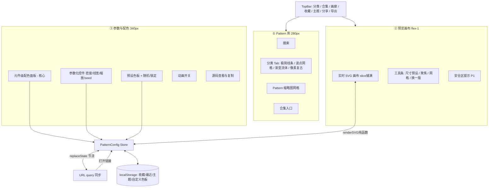

# SVG 壁纸生成器（Vector Wallpapers）产品需求文档

| 项目信息 | 内容                                                                          |
| ---- | --------------------------------------------------------------------------- |
| 项目名称 | `vector-wallpapers`                                                         |
| 文档类型 | 简单 PRD（不做竞品分析与市场象限图）                                                        |
| 语言   | 中文                                                                          |
| 技术栈  | Vite + React + MUI + Tailwind CSS，部署至 Cloudflare Workers（纯静态 SPA，无后端 /无数据库） |
| 文档日期 | 2026-10-10                                                                  |

---

## 1. 原始需求复述

用户要做一个**在线生成 SVG 桌面背景图（wallpaper）的网站**。不同于传统"素材库"（下载固定素材），本产品定位为**壁纸生成器 / 壁纸工坊**：用户选择一种 Pattern 母题 → 逐个调整构成它的**元件（element）**&#x989C;色与参数 → 实时预览 → 导出 SVG / PNG 或复制源码。纯静态部署，配置通过 URL 分享。

---

## 2. 产品定义

### 2.1 一句话定位

> **一个在浏览器里把「Pattern 母题」拆成「可独立配色的元件」的 SVG 壁纸生成器 —— 调色，而不是找图。**

对标差异（对标分析仅此一句，不展开）：参考站点 svgbg 提供的是"**已做好的素材 + 事后改色**"；本产品是"**先定结构、再逐件配色**"，元件级配色是一等公民，Pattern 本身由参数 + seed 生成，同一 Pattern 可产出无限变体。

### 2.2 Product Goals

| #  | 目标                                 | 可度量标准                                  |
| -- | ---------------------------------- | -------------------------------------- |
| G1 | 让用户在 **60 秒内** 从零得到一张可用的个性化 SVG 壁纸 | 新用户完成"选母题 → 配色 → 导出"的中位耗时 ≤ 60s        |
| G2 | 让"元件级配色"成为可被发现、可操作的核心体验            | ≥ 80% 的导出会话中至少修改过 2 个元件颜色；元件面板曝光率 100% |
| G3 | 让每张成品**天然可分享、可复现**（无后端前提下）         | 分享链接打开后配置还原成功率 100%；用户无需登录即可分享与收藏      |

### 2.3 User Stories（用户故事）

1. 作为**设计师**，我想按风格分类浏览 Pattern 母题，以便快速找到符合项目调性的那一类，而不是在杂乱素材里翻找。
2. 作为**设计师**，我想**逐个元件**改色（底色 / 点1 / 点2 / 山峦x3），以便精确控制画面层次，而不是整体换色后撞色。
3. 作为**设计师**，我想一键套用**预设色板**，以便快速得到和谐配色，同时保留微调入口。
4. 作为**设计师**，我想**随机生成配色**并可锁定某个元件不被覆盖，以便在探索灵感时保留已满意的部分。
5. 作为**设计师**，我想调**密度 / 线宽 / 缩放 / 层数**等参数，以便让图案适配不同屏幕的视觉密度。
6. 作为**设计师**，我想输入 **seed** 或点"换一版"，以便在同母题下探索构图差异。
7. 作为**开发者**，我想在 **1920×1080 / 3440×1440 带鱼屏 / 手机竖屏 / iPad** 等常用比例间切换，以便同一张图适配桌面与移动端。
8. 作为**开发者**，我想**实时看到 SVG 源码**并一键复制，以便直接粘进 HTML/CSS，不用来回导出再打开文件。
9. 作为**开发者**，我想**下载 SVG**（矢量、体积小、可再编辑）与**下载 PNG**（@1x/2x/3x），以便覆盖设计稿与办公场景的位图需求。
10. 作为**用户**，我想把当前配置**编码进 URL**，以便把壁纸分享给朋友，对方打开就是同一张图。
11. 作为**用户**，我想把喜欢的配置**收藏到本地**，以便下次回来快速找回我的配色方案。
12. 作为**用户**，我想在**深色 / 浅色界面**之间切换，以便配合我的工作环境，也顺便预览壁纸在两种桌面下的观感。
13. 作为**用户**，我想让线条 / 波点 / 渐变**缓慢动起来**（可选动画），以便屏幕更有生气，且能导出为带 CSS/SMIL 动画的 SVG。

---

## 3. 功能需求池（Requirements Pool）


### 3.1 P0 — Must have（首个可用版本必须有）

#### P0-1 Pattern 分类体系

4 个一级分类（用户已确认），共 **19 个 Pattern**：

| #  | Pattern id        | 中文名   | 分类            | 核心元件（示例）                           | 主要参数                         | 优先级 |
| -- | ----------------- | ----- | ------------- | ---------------------------------- | ---------------------------- | --- |
| 1  | `flow-lines`      | 流线曲   | A极简几何线条       | 底色 + 线束（3 层可分色）                    | 密度 / 线宽 / 曲率 / seed / 动画     | P0  |
| 2  | `offset-grid`     | 错位方格  | A 极简几何线条      | 底色 + 竖线组 + 横线组 + 强调块               | 格距 / 线宽 / 错位量 / seed         | P0  |
| 3  | `arc-composition` | 弧光构成  | A 极简几何线条      | 底色 + 大弧 + 中弧 + 小弧 + 圆点             | 弧宽 / 半径 / 线宽 / seed          | P0  |
| 4  | `contour-rings`   | 等高线圈  | A 极简几何线条      | 底色 + 圈层（可分 2~3 色带）                 | 层数 / 间距 / 线宽 / seed          | P0  |
| 5  | `bauhaus-blocks`  | 包豪斯块面 | A 极简几何线条      | 底色 + 圆 + 半圆 + 三角 + 方块              | 尺寸 / 旋转 / 圆角 / seed          | P0  |
| 6  | `polka-dots`      | 波点圆点  | B 波点 / 网格重复   | 底色 + 点（大）+ 点（中）+ 点（小）              | 密度 / 尺寸层级 / 错位 / seed        | P0  |
| 7  | `hex-grid`        | 六边形网格 | B 波点 / 网格重复   | 底色 + 网格线 + 填充六边形                   | 边长 / 线宽 / 填充率 / seed         | P0  |
| 8  | `diamond-lattice` | 菱形格纹  | B 波点 / 网格重复   | 底色 + 菱形A + 菱形B                     | 格距 / 线宽 / 填充率 / seed         | P0  |
| 9  | `triangle-tiling` | 三角铺排  | B 波点 / 网格重复   | 底色 + 上三角 + 下三角                     | 边长 / 线宽 / 错位 / seed          | P0  |
| 10 | `checker-mesh`    | 棋盘格   | B 波点 / 网格重复   | 底色 + 格A + 格B                       | 格数 / 圆角 / 线宽 / seed          | P0  |
| 11 | `dusk-ridges`     | 山峦日落  | C 渐变流体 / 有机形态 | 天空渐变 + 太阳 + 远山 + 中山 + 近山 + 前景      | 层数 / 山高 / 渐变角度 / seed        | P0  |
| 12 | `liquid-mesh`     | 流体渐变  | C 渐变流体 / 有机形态 | 底色 + 渐变团A + 渐变团B + 团C（各含 2~3 stop） | 形变幅度 / 团数 / 模糊 / seed / 动画   | P0  |
| 13 | `cloud-bands`     | 云层带   | C 渐变流体 / 有机形态 | 天顶渐变 + 云带 x3 + 光晕                  | 云带数 / 厚度 / 偏移 / seed / 动画    | P0  |
| 14 | `aurora-wave`     | 极光波浪  | C 渐变流体 / 有机形态 | 夜空渐变 + 极光带x2 + 星点                  | 波幅 / 层数 / seed / 动画          | P0  |
| 15 | `blob-field`      | 有机斑点场 | C 渐变流体 / 有机形态 | 底色 + 斑点（3 组可分色）                    | 斑点密度 / 尺寸 / 边缘柔软度 / seed     | P0  |
| 16 | `memphis-grid`    | 孟菲斯网格 | D 像素 / 复古游戏   | 底色 + 波浪线 + 锯齿 + 圆点 + 三角 + 方块       | 网格数 / 元件尺寸 / 旋转 / seed       | P0  |
| 17 | `neon-pixels`     | 霓虹像素  | D 像素 / 复古游戏   | 底色 + 像素块（4 组可分色）                   | 像素大小 / 色数 / 噪点密度 / seed / 动画 | P0  |
| 18 | `new-wave-sunset` | 新浪潮落日 | D 像素 / 复古游戏   | 落日渐变 + 太阳条纹 + 地平线 + 剪影             | 太阳位置 / 条纹数 / 地平线高度 / seed    | P0  |
| 19 | `pixel-terrain`   | 像素地形  | D 像素 / 复古游戏   | 天空渐变 + 远山 + 中山 + 前景 + 水面           | 阶数 / 高度 / seed               | P0  |

> 上表 id 命名约束：小写 kebab-case，**一经上线不可重命名**（URL 分享依赖稳定性）。

#### P0-2 元件级配色系统（核心差异化，必须做到）

**数据模型：一个 Pattern = 若干有序元件（back → front），每个元件独立持有自己的"填充"与"不透明度"。**

```ts
type PaintSpec =
  | { type: 'solid';   color: string }                       // 单色
  | { type: 'linear';  angle: number;                        // 0~360
      stops: Array<{ offset: number; color: string }> }       // 2~5 个色标
  | { type: 'radial';  cx: number; cy: number; r: number;    // 归一化坐标
      stops: Array<{ offset: number; color: string }> }
  | { type: 'none' };// 不绘制/透明

interface ElementSpec {
  id: string;                // 稳定 id，如 "ridge_far"
  label: string;             // 中文显示名，如 "山峦 · 远"
  role: 'bg' | 'primary' | 'secondary' | 'accent' | 'detail';
  paint: PaintSpec;
  opacity: number;           // 0~1
  visible: boolean;
  locked?: boolean;          // 随机配色时不被覆盖
}

interface PatternDef {
  id: PatternId;
  name: string;
  category: 'A-lines' | 'B-repeat' | 'C-organic' | 'D-pixel';
  elements: ElementSpec[];// 顺序 = 绘制顺序（先到后）
  controls: ControlDef[];         // 参数化控件定义
  seedable: boolean;
  animatable: boolean;
}

interface PatternConfig {          // 完整可序列化的用户配置
  patternId: PatternId;
  width: number; height: number;
  seed: number;
  elements: Array<{ id: string; paint: PaintSpec; opacity: number; visible: boolean; locked: boolean }>;
  params: Record<string, number | string | boolean>;  // 由 controls 校验
}
```

**关键架构约束（给 architect）：**

- 渲染必须是**纯函数** `renderSVG(patternDef, config): string` —— 预览 DOM、SVG 下载、PNG 导出、源码复制**共用同一份渲染结果**，不允许出现"预览好看但导出不一致"。
- 所有颜色/参数最终以**CSS 自定义属性或SVG 属性**注入到 DOM，禁止把颜色硬编码进pattern 模板。
- `elements` 的**顺序即 z 轴**，用户调整的是**值**，不是顺序（避免复杂交互）；如需隐藏某元件，设 `visible=false`。

**调色板交互（P0 范围）：**

| 能力              | 交互                                                                      | 说明                                                               |
| --------------- | ----------------------------------------------------------------------- | ---------------------------------------------------------------- |
| **元件级取色**       | 每个元件行内含：色板色块 + 原生取色器 + HEX 输入                                           | 修改即时反映在画布上；元件行可折叠、可隐藏（眼睛图标）                                      |
| **预设色板**        | 顶部色板选择器，≥ 10 套命名色板（极地 / 灰调 / 莫兰地 / 落日 / 苔原 / 霓虹 / 孟菲斯 / 复古印刷 / 夜航 / 单色） | 套用时按 `role` 语义映射到元件（如 `bg`→底色、`accent`→强调元件），映射表内置于每个 PatternDef |
| **按 role 批量改色** | 点击元件行的"色组"标签（如"强调色 ×2"），一次改多个同 role 元件                                  | 大幅降低"山峦x3 要改3次"的成本                                               |
| **随机 / 生成配色**   | "随机配色"按钮 + 锁定开关                                                         | 从当前色板或全色域取色；`locked=true` 的元件保持不变；支持"仅随机某 role"                  |
| **从画布取色**       | P1：吸管点击画布上某元件 → 直接改其颜色                                                  | 反向映射需渲染层提供元件命中信息                                                 |

#### P0-3 参数化控制（按 Pattern 类型差异化）

| 分类          | 控件（P0）                       | 控件（P1）                |
| ----------- | ---------------------------- | --------------------- |
| A 极简几何线条    | 密度、线宽、缩放、曲率/圆角、旋转、随机种子       | 复杂度（图形数量）、动画（线条流动）    |
| B 波点 / 网格重复 | 单元尺寸、密度、线宽、错位(stagger)、旋转、种子 | 填充率、动画（脉冲 / 波纹）       |
| C 渐变流体 / 有机 | 形变幅度、层数、渐变角度、柔和度（模糊）、种子      | 动画（缓慢漂移）、颗粒噪点         |
| D 像素 / 复古   | 像素/网格大小、元件数量、旋转、种子           | 噪点密度、色数限制、动画（闪烁 / 滚动） |

通用控件（所有 Pattern）：**随机种子 seed（数字输入 + "换一版" 骰子按钮 + 锁定）**、动画开关（当 `animatable`）。

#### P0-4 尺寸预设

| 预设        | 比例     | 用途                |
| --------- | ------ | ----------------- |
| 1920×1080 | 16:9   | 主流桌面 / FHD        |
| 2560×1440 | 16:9   | QHD 桌面            |
| 3440×1440 | 21:9   | 带鱼屏 ultrawide     |
| 3840×2160 | 16:9   | 4K 桌面             |
| 1170×2532 | 19.5:9 | iPhone 竖屏         |
| 1290×2796 | 19.5:9 | iPhone Pro Max 竖屏 |
| 2048×2732 | 3:4    | iPad 竖屏           |

另需：**跟随当前屏幕**（默认选中）、**横向/纵向一键翻转**、**自定义尺寸**（宽高输入 + 锁定宽高比）。  
因Pattern 均为`preserveAspectRatio="xMidYMid slice"` 全出血铺满，切换尺寸不裁切主体。

#### P0-5 预览与导出

- **实时预览**：画布等比缩放显示（CSS transform 缩放，不重排），参数变更 < 100ms 反馈（SVG 字符串 diff 或整体替换 + rAF 节流）。
- **导出 SVG**：下载 `.svg` 文件；文件内嵌必要属性，**不依赖外部 CSS / 字体 / 图片**（可离线可用）。
- **导出 PNG**：客户端 canvas 光栅化，倍率 @1x / @2x / @3x；PNG 导出在**主线程外**或分片执行，避免大尺寸卡顿。
- **复制 SVG 源码**：一键复制完整 SVG 文本。
- **复制 CSS / HTML**：P1，输出 `background-image: url("data:image/svg+xml,...")` 与 `` 片段（参考站点同类能力，对齐开发者场景）。
- **源码查看面板**：可折叠，实时高亮，等宽字体，一键复制。

#### P0-6 URL 状态同步（分享 / 复现）

无后端，因此配置**完全编码进 query string**：

```
/?p=dusk-ridges&w=3440&h=1440&seed=1287
  &cols=%230f2027,%23f9c74f,%232a9d8f,%23264165,%231a5f7a
  &params=layers:4,ridgeH:0.42
  &ui=panel:right,theme:dark
```

- `p` patternId；`w/h` 尺寸；`seed` 种子；`cols` **按 Pattern.elements 的固定顺序**排列的元件 paint 编码（单色为 `#rrggbb`；渐变编码为 `angle:stops` 简写）；`params` 参数键值对（分号分隔）；`ui` 仅存界面态。
- 打开 URL 必须 **100% 还原**画布、面板状态、主题。
- 非法/未知参数**降级为默认值**并静默忽略，不得白屏。
- 画布每次变更 **replaceState 节流写入**（不刷历史记录），另提供"复制分享链接"按钮。
- P1：URL 长度超限时对 `params` 做键名压缩；P2：短链服务（需外部，故与"无后端"冲突，仅列为可选）。

#### P0-7 画廊 / 合集浏览与收藏

- **分类导航**：4 个分类 Tab（极简线条 / 波点网格 / 渐变流体 / 像素复古），每 Tab 显示 Pattern 网格。
- **缩略图**：每个 Pattern 用其默认配置离屏渲染一张缩略图（懒加载）。
- **合集（Curated Sets）**：≥ 6 个精选合集（如「冷静办公」「暗黑开发」「童年游戏厅」「柔光卧室」），每个合集 = 一组预置完整配置，点击即整套应用。
- **收藏**：localStorage 存储完整 `PatternConfig` + 名称 + 时间；收藏页可重命名、导出、删除；提供 5 个本地默认收藏位引导。
- **最近使用**：localStorage 记录最近 8 个配置。

#### P0-8 深色 / 浅色主题

- 三态：`跟随系统 / 浅色 / 深色`，localStorage 持久化。
- 界面主题与壁纸本身**互相独立**（壁纸是用户产物，不随主题变）。
- 首屏无闪烁（内联脚本读取localStorage 预置 `data-theme`）。

#### P0-9 零依赖与可访问性

- 界面**不加载任何 Web Font**（用系统字体栈），避免影响 SVG 导出纯净度。
- 所有控件具备 `aria-label`；键盘可达；焦点态可见；对比度满足 WCAG AA。

### 3.2 P1 — Should have

1. **吸管取色**：点击画布元件直接改色（P0-2 表格所述反向映射）。
2. **预设管理**：用户可保存/删除自定义色板；色板数据存 localStorage。
3. **复制 CSS / HTML 代码片段**（含 `data:image/svg+xml` URL encode 版本）。
4. **网格 / 标尺叠加**：预览上叠加像素网格，辅助对齐（默认关闭）。
5. **动画导出**：导出含 SMIL/CSS `<animate>` 的 SVG，或导出 `.gif`（P2）。
6. **对比度检查**：提示当前配色在浅色/深色桌面图标下的可读性。
7. **快捷键**：`R` 换 seed、`C` 复制源码、`E` 导出 SVG、`D` 下载 PNG、`F` 收藏。
8. **图片上传 / 图标适配**：允许用户上传前景图（如 logo），叠加到壁纸上（P2，可选）。
9. **批量导出**：同一 Pattern 的多seed 变体一次性导出 ZIP（需 JSZip，纯前端可行）。
10. **键盘快捷的"隐藏面板"专注模式**：预览全屏。
11. **多语言（i18n）**：框架层预留，首版仅中文。
12. **壁纸安全区提示**：显示图标安全区（避免关键内容被桌面图标遮挡）。

### 3.3 P2 — Nice to have

1. **AI 配色建议**：输入关键词（如"雨夜书房"）返回配色方案（需外部 API，与无后端冲突 → 纯前端可改为本地HSL 规则引擎）。
2. **Pattern 上传 / 自定义模板**：用户粘贴 SVG 作为新 Pattern 母题。
3. **GIF / APNG 动画导出**。
4. **视频壁纸（WebM）导出**：前端编码，体积与性能需验证。
5. **壁纸订阅**：定期（纯静态可用外部 RSS/JSON）推送精选配置。
6. **深色模式下的"玻璃拟态"预览框**（模拟桌面）。
7. **预设分享为图片**：把配置渲染成带参数的分享卡片 PNG。

### 3.4 非功能需求（NFR）

| 类别  | 要求                                                                                          |
| --- | ------------------------------------------------------------------------------------------- |
| 体积  | 单 Pattern SVG 产物 **< 20KB**（参考站点卖点）；全站 JS 首屏 gzip **< 300KB**                               |
| 性能  | 画布参数变更 **< 100ms** 反馈；首屏可交互 **< 1.5s**（4G）                                                  |
| 兼容性 | Chrome / Edge / Safari / Firefox 最近两个大版本；macOS + Windows + iOS + Android                    |
| 部署  | Cloudflare Workers 单文件返回静态资源；需支持 **SPA 回退**（未知路径返回 index.html）与正确的 `Content-Type`；无需服务端 API |
| 隐私  | 无追踪、无第三方请求（除静态资源）；所有用户数据仅存 localStorage                                                     |
| 健壮性 | 未知 patternId / 非法参数 / localStorage 数据损坏 →降级默认值，不白屏                                          |
| SEO | 单页 + 静态 `meta`/OG 图；每Pattern 可通过 `?p=` 分享但不做 SSR（P2 考虑预渲染）                                  |

---

## 4. UI 设计稿说明

### 4.1 桌面端布局（≥ 1280px）— 三栏工作台

```
┌──────────────────────────────────────────────────────────────────────────────┐
│  ⬤ Vector Wallpapers    [分类: 线条|波点|流体|像素]   [合集▾] [画廊] [☆收藏]  │ ← TopBar 56px
│                                          [☀/🌙 主题]  [复制链接] [导出▾]     │
├───────────────┬──────────────────────────────────────────┬───────────────────┤
│ ① Pattern 库   │                ② 预览画布                │  ③ 参数 & 配色     │
│   280px       │                    flex-1                │      340px│
│               │                                          │                   │
│ [搜索框]       │   ┌────────────────────────────────┐     │ ┌ 元件 Colors ───┐│
│               │   │                                │     │ │ 👁 🔒 底色      ││
│ ▸ 极简线条(5)  │   │      实时 SVG 预览画布          │     │ │   [色块][取色器] ││
│  ┌─┐┌─┐┌─┐    │   │   (等比缩放 / 可切聚焦全屏)      │     │ ├────────────────┤│
│  │缩││缩││缩│   │   │                                │     │ │ 👁 🔒 山峦 · 远 ││
│  └─┘└─┘└─┘    │   └────────────────────────────────┘     │ │   [色块][取色器] ││
│               │   [1920×1080 ▾] [⤢ 聚焦] [⊞ 网格] [⟳ 换一版] │ ├────────────────┤│
│ ▸ 波点网格(5)  │                                          │ │ 强调色 ×2  [批量] ││
│  ┌─┐┌─┐┌─┐    │                                          │ └────────────────┘│
│               │                                          │ ┌ 色板 Palettes ─┐│
│ ▸ 渐变流体(5)  │                                          │ │ ▪▪▪ 极地 落日 … ││
│               │                                          │ │ [随机配色][锁定] ││
│ ▸ 像素复古(4)  │                                          │ └────────────────┘│
│               │                                          │ ┌ 参数 Params ───┐│
│               │                                          │ │ 密度 ────●──── ││
│               │                                          │ │ 线宽 ──●─────── ││
│               │                                          │ │ seed  [1287][🎲]││
│               │                                          │ │ 动画 [ ○—]       ││
│               │                                          │ └────────────────┘│
│               │                                          │┌ 源码 Source ────┐│
│               │                                          │ │ <svg …>    [复制] ││
│               │                                          │ └────────────────┘│
└───────────────┴──────────────────────────────────────────┴───────────────────┘
```

交互要点：

- **①Pattern 库**：选中项高亮 + 左侧色条；再次点击已选 Pattern → **重新随机配色**（快速"洗牌"）。
- **③ 元件面板为页面视觉主角**：元件行 = `眼睛(显隐) | 锁(随机时锁定) | 中文名 | role 批量标签 | 色块(打开色板) | 取色器 | HEX 输入`。渐变元件额外显示 `类型切换(单色/线性/径向) + 角度/色标列表`。
- 面板支持**拖拽排序**？→ P2，首版不做（顺序由 Pattern 定义固定）。

### 4.2 Mermaid 结构图



### 4.3 窄屏与移动端降级策略（< 1024px）

采用**单栏 + 底部抽屉（Bottom Sheet）**，不做真双栏：

```
┌───────────────────────────┐
│ ⬤ Vector Wallpapers   ⋮  │  TopBar 精简为: 菜单 / 分享 / 导出
├───────────────────────────┤
│      预览画布 (占主视野)   │  画布高度 ≈ 视口 - 200px
│                           │
├───────────────────────────┤
│ [🎨 配色] [⚙️ 参数] [▦ 图库] │ ← 底部三Tab 抽屉把手
├───────────────────────────┤
│▼ 抽屉内容 (可上拉至 70vh) │
│  元件列表(可横向滑动卡片)  │
│  色板 / 参数 / 源码         │
└───────────────────────────┘
                         ▲ 上拉展开 / 下拉收起
```

- 断点：`≥1280px` 三栏；`768–1279px` 两栏（左栏折叠为图标抽屉）；`<768px` 单栏 + 底部抽屉。
- 元件色板在窄屏改为**横向滚动的色块卡片**，每张卡片 = 一个元件（含名称、色块、取色器），拇指可达。
- 移动端默认尺寸预设自动切换到"跟随屏幕"（即 1170×2532 等实际视口 px）。
- 导出 PNG 上限降为 @2x（避免内存溢出）。

---

## 5. 用户决策（2026-10-10 已全部拍板）

> 以下 10 项已由需求方确认，**本文档为产品事实来源，实现须严格遵循**。

| # | 问题 | **决策** |
|---|------|---------|
| Q1 | 导出 SVG 是否允许动画 | **导出静态**（动画仅在预览中呈现，不写入导出产物） |
| Q2 | 首版 Pattern 数量 | **12 个**（每类 3 个）：A 线条 `flow-lines` / `offset-grid` / `bauhaus-blocks`；B 波点 `polka-dots` / `hex-grid` / `diamond-lattice`；C 流体 `dusk-ridges` / `liquid-mesh` / `aurora-wave`；D 像素 `memphis-grid` / `neon-pixels` / `new-wave-sunset`。其余 7 个列入后续批次，架构须预留可追加 |
| Q3 | 随机配色色彩范围策略 | **策略 C —— 智能邻近色 HSL 规则**（同时提供「仅当前色板」与「全色域 HSL」两种模式切换） |
| Q4 | 是否需要用户自建并分享色板 | **不需要**，首版只内置预设色板 |
| Q5 | 默认首屏 Pattern | **`polka-dots`** |
| Q6 | 是否需要文字 / Logo 叠加层 | **不需要**，纯背景图（此决策同时消除字体嵌入与授权风险，并保证导出纯净度） |
| Q7 | 合集由谁定义 | **预置 6–8 套固定合集** |
| Q8 | PNG 导出最大尺寸与倍率上限 | **最长边 7680px、@3x**，导出在**本地浏览器**执行（零后端） |
| Q9 | 是否需要 PWA / 离线可用 | **不需要** |
| Q10 | URL 分享是否需要短链 | **不需要**，使用完整长 URL（零依赖） |

### 5.1 决策带来的连带影响

| 决策 | 对实现的影响 |
|------|-------------|
| Q1 导出静态 | 引擎 `animatable` 能力仅供预览，导出管线必须剥离动画节点，保证「同配置两次导出字节一致」 |
| Q2 只做 12 个 | 画廊、合集、预渲染页面均按 12 个组织；registry 与预渲染脚本须支持后续零改动追加 |
| Q3 邻近色规则 | `colors.ts` 需实现 HSL 邻近色算法（类比色相轮 / 黄金角），并提供三档取色模式切换控件 |
| Q5 默认 `polka-dots` | 首屏路由与默认 config 指向 `polka-dots` |
| Q6 无文字 | 移除文字图层相关设计；进一步强化「禁止 `<text>` 元素」铁律 |
| Q8 7680px/@3x | 需 `guardCanvasSize()` 尺寸守卫：超限时**自动降级并提示，不可静默失败**。注意 iOS Safari canvas 上限约 16.7M px |
| Q9 无 PWA | 不写 manifest、不写 service worker |


---

## 6. 验收标准（Definition of Done, P0 范围）

1. 19 个（或 Q2 确认后的数量）Pattern 全部可在分类 Tab 中浏览，且各有默认配置缩略图。
2. 每个 Pattern 的**每个元件**均可独立：改色、改不透明度、显隐；改动 < 100ms 反映到画布。
3. 渐变型元件可在"单色 / 线性渐变 / 径向渐变"间切换并编辑色标。
4. 预设色板套用、随机配色、锁定、按 role 批量改色均可用。
5. 尺寸预设 7 个 + 跟随屏幕 + 自定义 + 翻转均生效，且无拉伸变形。
6. 导出 SVG / PNG@2x / 复制源码三路径产出**一致**（与预览逐像素一致）。
7. 复制当前 URL 到新标签打开，画布、参数、主题、面板状态完全还原。
8. 收藏可保存 / 重命名 / 恢复 / 删除，刷新后仍在。
9. 深色 / 浅色 / 跟随系统三态生效，首屏无主题闪烁。
10. 生成的 SVG 单文件 < 20KB，无外部引用，导入 Illustrator/Figma 可正常打开且形状可编辑（渐变可编辑）。
11. 部署至 Cloudflare Workers 后，直接访问任意子路径不 404（需 SPA 回退）。
12. 非法 URL 参数不导致白屏。
