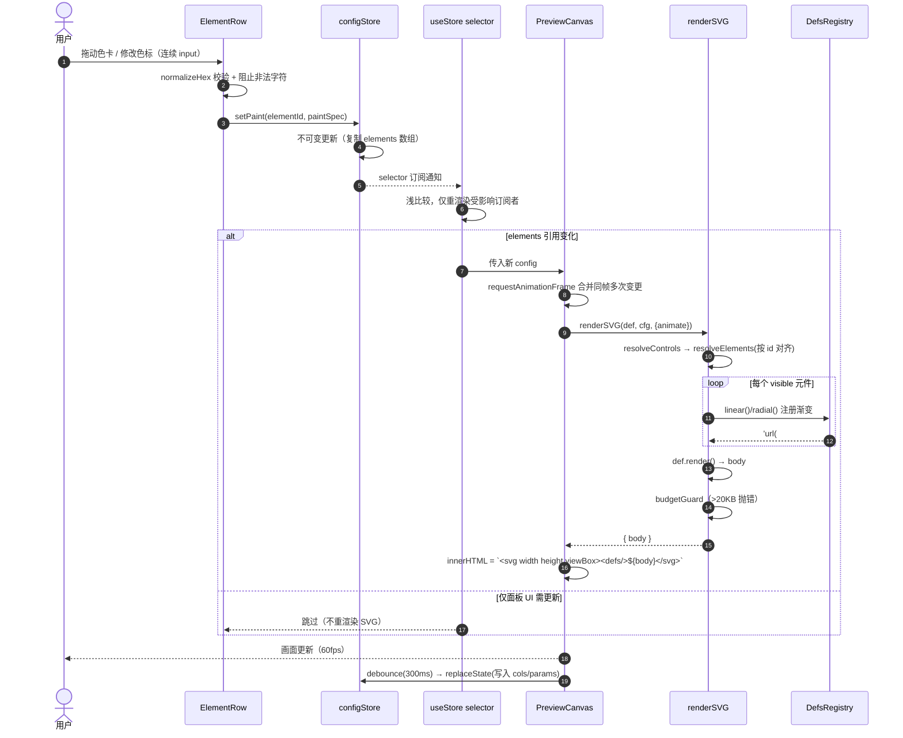
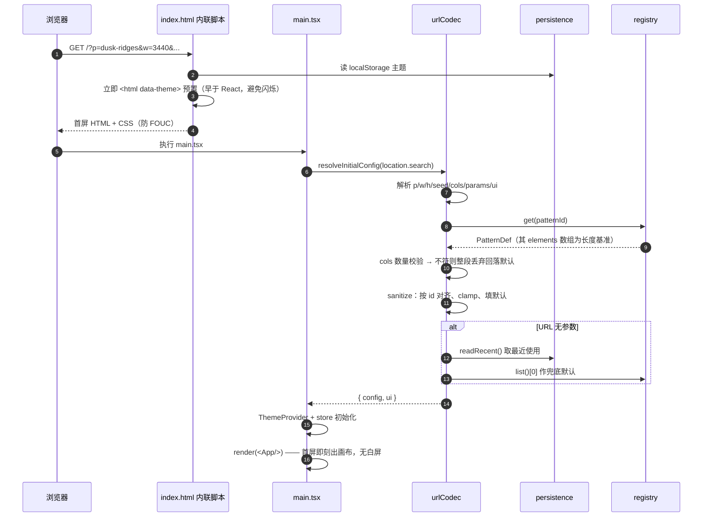

# SVG 壁纸生成器（Vector Wallpapers）— 系统架构设计

> 版本：v2.0（对齐 PRD v1.0 修订版）
> 目标平台：Cloudflare Workers · 纯静态 SPA · 无后端 · 无数据库
> 配套文档：`docs/PRD.md`

**本次修订说明**：v1.0 草案基于口头 brief 独立设计，产出后读取 `PRD.md` 发现 **7 处实质性冲突**（技术栈、Pattern 数量与 id、渐变 PaintSpec、元件数据结构、URL 格式、体积预算、色板系统）。v2.0 已全部对齐 PRD，PRD 为产品事实来源，冲突处以 PRD 为准。详见 §0.2。

---

## 0. 决策速览

### 0.1 关键决策

| 决策项 | 结论 | 依据 |
|---|---|---|
| 前端框架 | **React 19**（遵循 PRD） | PRD 指定；NFR 300KB 预算下可满足 |
| 组件库 | **MUI 9**，但**强制深路径导入** | PRD 指定；barrel 导入会突破体积预算（见 §1.3） |
| 样式方案 | **Tailwind v4 + MUI Theme 双轨** | 布局用 Tailwind，组件样式用 MUI，二者以 CSS 变量桥接 |
| 状态管理 | **自研 external store（零依赖）** | 状态即一个 `PatternConfig` 对象；且避免 Redux/Zustand 与 MUI 混用带来的 Provider 嵌套 |
| 构建工具 | **Vite 8** | PRD 指定 |
| 部署形态 | **Vite → Workers Static Assets，零 Worker 脚本** | 静态资源免费无限、不计 CPU（见 §1.4） |
| 渲染引擎 | **纯函数 `renderSVG(patternDef, config): string`** | PRD P0-2 硬性约束；预览/下载/复制共用同一份输出 |
| 元件数据结构 | **有序数组**（顺序 = z 轴） | PRD 明确要求，数组顺序即绘制顺序 |
| 渐变 | **`PaintSpec` 三态**（solid / linear / radial / none） | PRD 核心需求，由 `DefsRegistry` 承载 |
| URL 状态 | **遵循 PRD 格式** `?p=&w=&h=&seed=&cols=&params=&ui=` | PRD P0-6；含 `ui` 段（面板状态 + 主题） |
| 体积红线 | **单 Pattern SVG < 20KB**，开发期硬断言 | PRD NFR；强制 `<pattern>` 平铺 |
| PNG 导出 | **主线程分片 + OffscreenCanvas 渐进增强** | PRD NFR「主线程外**或**分片执行」 |

### 0.2 v1.0 → v2.0 冲突修订记录

| # | 冲突点 | PRD 要求 | v1.0 草案 | 修订结果 |
|---|---|---|---|---|
| 1 | 前端框架 | React 19 + MUI | Preact + 零组件库 | ✅ 改用 React 19 + MUI 9，增加深路径导入与体积门禁 |
| 2 | Pattern 数量与 id | **19 个**，id 已锁定（如 `flow-lines`） | 自创 12 个，id 不同 | ✅ 全部替换为 PRD 的 19 个锁定 id |
| 3 | 元件数据结构 | `elements: Array<{id, paint, opacity, visible, locked}>` 有序数组 | `Record<string, ElementStyle>` 映射 | ✅ 改为有序数组（顺序即 z 轴） |
| 4 | 颜色模型 | `PaintSpec` 支持 **linear / radial 渐变** + 多色标 | 仅单色 `color: string` | ✅ 新增 PaintSpec 联合类型 + 渐变 defs 生成 |
| 5 | URL 格式 | `?p=&w=&h=&seed=&cols=&params=&ui=`，含面板与主题 | 自创 `?v=&p=&s=&d=&t=&c=` | ✅ 完全改用 PRD 格式，主题/面板进 URL |
| 6 | 分类枚举 | `'A-lines' \| 'B-repeat' \| 'C-organic' \| 'D-pixel'` | `'minimal' \| 'dots' \| 'fluid' \| 'pixel'` | ✅ 采用 PRD 枚举值 |
| 7 | 体积红线 | 单 Pattern SVG **< 20KB** | SVG ≤ 800KB | ✅ 收紧至 20KB，并升级为开发期 `throw` 级断言 |

> 保留自 v1.0 且经验证仍成立的技术结论：Workers 限额已放宽（§1.4）、PNG 导出的五个坑（§9.3）、`<pattern>` 平铺性能铁律（§4.4）、`<text>` 禁用约定（§9.3 坑 5）。

### 0.3 对 brief 中两处**已过时约束**的纠正（已核实 Cloudflare 官方文档，2026-10）

1. **「Worker 1MB 脚本限制」已取消。** Cloudflare 于 2026-09-04 起改为**统一 64 MiB（未压缩）**，Free 与 Paid 同等，仅检查未压缩体积，`gzip` 数值不再作为限制。
   （仍有效：100K 请求/天、10ms CPU/请求、128MB 内存、50 子请求。）
2. **「静态资源 20 个文件上限」已放宽至 20,000 个**，单文件 25 MiB，需 wrangler ≥ 4.34.0。
   → PRD 的「单文件返回静态资源 + SPA 回退」用 Workers Static Assets 完全满足，且**零 Worker 脚本**即可实现。

---

## 1. 技术栈选型

### 1.1 为什么遵循 PRD 的 React + MUI（而非更轻的方案）

我曾评估过 Preact + 零组件库（可省约 70KB gzip），但**不采纳**，理由：

1. PRD 已明确指定 React + MUI，产品与技术决策应一致，工程师无需二次判断。
2. PRD 的元件配色面板需要大量成熟控件（Popover / Tooltip / Slider / Tabs / Accordion / Snackbar），MUI 能显著降低 UI 层工作量与视觉缺陷率 —— 这部分工时节省远超体积成本。
3. NFR 预算 300KB 在正确导入下可满足（§1.3 实测估算）。

**保留的优化措施**：架构上把 MUI **隔离在 `src/ui/mui/` 适配层内**，业务组件只 import 自适配层，不直接依赖 MUI 组件。这样即便将来要换库，业务代码零改动。

### 1.2 Tailwind v4 + MUI 双轨集成方案（关键实现细节）

两者都会争夺样式所有权，必须显式分工，否则出现「MUI 按钮被 Tailwind preflight reset」等问题。

```
┌─ Tailwind v4 ────────────────┬─ MUI 9 ─────────────────┐
│ 负责：布局(flex/grid)         │ 负责：交互组件的视觉      │
│      间距 / 定位 / 响应式     │      Button/Slider/Tabs   │
│      自定义工具类             │      Popover/Snackbar    │
│      动画                     │      以及所有交互状态     │
└───────────────────────────────┴─────────────────────────┘
              ↕ 唯一耦合点：CSS 变量
        src/styles/theme.css 的 --vw-* token
```

**三条集成铁律：**
1. **Tailwind preflight 全局禁用**（`@import "tailwindcss" layer(utilities);` 语法只导入 utilities，跳过 preflight），避免 reset 破坏 MUI 组件结构。
2. **MUI Theme 消费同一套 CSS 变量**：在 `createTheme()` 中用 `var(--vw-brand)` 而非硬编码色值，实现主题一键切换。
3. **业务组件禁止直接 `import { X } from '@mui/material'`**（barrel 导入会连带整个包），统一从 `@mui/material/Button` 等深路径导入。

### 1.3 体积预算与门禁（PRD NFR：首屏 gzip < 300KB）

| 模块 | 策略 | gzip 估算 |
|---|---|---|
| React 19 + ReactDOM | — | ~45 KB |
| MUI 9（**仅深路径导入** 12 个组件） | 关闭 `StyledEngine` 以外的非必要特性 | ~55 KB |
| Emotion（`@emotion/react` + `styled`） | MUI 必需，无法去除 | ~14 KB |
| 业务代码 + 19 个 Pattern 模块 | 纯函数，无重依赖 | ~35 KB |
| Tailwind 4 产物 | CSS，独立文件，不计 JS 预算 | ~14 KB |
| **合计（JS）** | | **~149 KB** ✅ 余量充足 |

**门禁（写进 T1 与 T2 验收）**：
- `vite.config.ts` 开启 `build.rollupOptions.output.manualChunks`，把 `react` / `mui` / `patterns` 拆成独立 chunk，便于缓存与排查。
- CI 增加体积检查：`gzip -c dist/assets/*.js | wc -c` 总和 > 300KB 则失败。
- **禁止**任何 `import { ... } from '@mui/material'` 顶层导入（可用 ESLint `no-restricted-imports` 规则强制）。

### 1.4 部署形态（PRD：Cloudflare Workers 单文件返回静态资源 + SPA 回退）

| 维度 | **(a) Vite + Workers Assets** ✅ | (b) 零构建原生 | (c) esbuild 单文件内联 |
|---|---|---|---|
| 迭代速度 | ✅ Vite HMR 毫秒级 | ❌ 无 HMR | ⚠️ 需维护内联映射 |
| PRD「SPA 回退」 | ✅ `not_found_handling` 原生支持 | ⚠️ 手写 | ⚠️ 手写 |
| 缓存 | ✅ hash 文件名 → immutable | ❌ 单 HTML | ❌ 资源焊进 JS，无法单独缓存 |
| CPU 配额 | ✅ **资源请求免费无限，不计 CPU** | ⚠️ 每次都执行 | ❌ 每次都执行 |
| 体积约束 | ✅ 不受脚本限制约束 | ✅ | ⚠️ 受 64 MiB |

**推荐 (a)，且不配置 `main` 字段** —— 这样 wrangler 不生成任何 Worker 脚本，静态资源由 Cloudflare 边缘直接服务，**完全绕开 100K 请求/天 与 10ms CPU 限制**。PRD 的「单文件返回静态资源」在此实现为「一次 `wrangler deploy` 上传整个 `dist/`，对用户表现为单一站点」。

### 1.5 依赖清单

**运行时依赖（4 个）**

| 包 | 版本 | 用途 |
|---|---|---|
| `react` | `^19.3.0` | UI 框架 |
| `react-dom` | `^19.3.0` | DOM 渲染 |
| `@mui/material` | `^9.5.0` | 组件库（**必须深路径导入**） |
| `@emotion/react` | `^11.14.0` | MUI 样式引擎必需 |

**开发依赖**

| 包 | 版本 | 用途 |
|---|---|---|
| `vite` | `^8.3.4` | 构建 |
| `@vitejs/plugin-react` | `^5.x` | React JSX + Fast Refresh |
| `typescript` | `~5.9.0` | 类型检查 |
| `tailwindcss` | `^4.3.3` | 原子化 CSS |
| `@tailwindcss/vite` | `^4.3.3` | Tailwind 官方插件 |
| `vitest` | `^4.x` | 单元测试 |
| `jsdom` | `^28.x` | 测试 DOM 环境 |
| `wrangler` | `^4.34.0` | 部署（**必须 ≥4.34.0** 才支持 20,000 文件配额） |

> **刻意不引入**：状态库、颜色库、SVG 库、序列化库、UI 图标库、路由库。理由见 §1.6。
> ⚠️ `typescript` 锁定 `~5.9.0`：npm `latest` 已是 7.0.2（原生重写版），本项目 Vite 用 esbuild 转译、tsc 仅做 `--noEmit`，但为避免意外漂移**显式锁定 5.9.x**。

### 1.6 自研 vs 引用的取舍

| 能力 | 决策 | 理由 |
|---|---|---|
| 状态管理 | **自研 ~60 行** | 状态就是一个 `PatternConfig`；引入库反而增加 Provider 嵌套与 MUI 主题的协调成本 |
| 颜色工具 | **自研 ~80 行** | 只需 hex↔rgb↔hsl、对比度；`chroma-js`/`colorjs` 数十 KB 过剩 |
| URL 编解码 | **自研 ~130 行** | 扁平 query 编解码逻辑简单且需与 PatternDef 强耦合 |
| 路由 | **不引入** | 只有单页 + `?p=` 参数切换，无需 react-router |
| 图标 | **内联 SVG 函数** | 少量图标不值得引入图标库 |

---

## 2. 核心架构分层

```mermaid
graph TB
    subgraph UI["UI 层 · src/ui（React + MUI）"]
        TOP["TopBar<br/>分类/合集/画廊/收藏/主题/分享/导出"]
        LIB["PatternLibrary 280px<br/>搜索+分类Tab+缩略图网格"]
        CAN["PreviewCanvas<br/>实时SVG + 工具条"]
        EPA["ElementPanel 340px<br/>元件级配色（核心）"]
        PRP["ParamControls<br/>参数化控件"]
        PAL["PaletteBar<br/>预设色板/随机/锁定"]
        SRC["SourcePanel<br/>源码查看与复制"]
        FAV["Gallery / Favorites / Sets"]
    end

    subgraph STATE["状态层 · src/state"]
        ST["configStore<br/>自研 external store"]
        ACT["actions<br/>setPaint/setParam/setSize/regenerate"]
        URL["urlCodec<br/>PRD 格式 ⇄ PatternConfig"]
        PER["persistence<br/>localStorage 收藏/最近/主题/色板"]
    end

    subgraph REG["Pattern Registry · src/patterns"]
        RG["registry<br/>register/get/listByCategory"]
        PA["A-lines × 5"]
        PB["B-repeat × 5"]
        PC["C-organic × 5"]
        PD["D-pixel × 4"]
    end

    subgraph ENGINE["渲染引擎（纯函数）· src/engine"]
        REND["renderSVG<br/>唯一渲染入口"]
        DEFS["DefsRegistry<br/>渐变/图案/裁剪 + 去重"]
        SB["svgBuilder<br/>el/rect/circle/path/use"]
        RNG["mulberry32<br/>确定性随机"]
        MAP["paintToPaintAttr<br/>PaintSpec → fill/stroke"]
        GUA["budgetGuard<br/>20KB 硬断言"]
    end

    subgraph EXPORT["导出层 · src/export"]
        SE["svgExport"]
        PE["pngExport<br/>分片 + OffscreenCanvas"]
        CP["clipboard<br/>SVG/CSS/HTML/data-URI"]
    end

    PRE["scripts/prerender.mjs<br/>P2 可选：SEO 预渲染"]

    TOP & LIB & CAN & EPA & PRP & PAL & SRC & FAV --> ST
    ST --> ACT
    ST --> URL
    ST --> PER
    ST --> REND

    REND --> RG
    REND --> DEFS
    REND --> SB
    REND --> RNG
    REND --> MAP
    REND --> GUA

    RG --> PA & PB & PC & PD
    PA & PB & PC & PD -.实现 PatternDef.-> REND

    SE --> REND
    PE --> REND
    CP --> REND
    PRE -.构建期调用同一引擎.-> REND

    classDef pure fill:#e8f5e9,stroke:#43a047,color:#1b5e20
    classDef ui fill:#e3f2fd,stroke:#1e88e5,color:#0d47a1
    classDef st fill:#fff3e0,stroke:#fb8c00,color:#e65100
    class REND,DEFS,SB,RNG,MAP pure
    class TOP,LIB,CAN,EPA,PRP,PAL,SRC,FAV ui
    class ST,ACT,URL,PER st
```



**分层铁律（违反即视为架构缺陷）：**
1. `src/engine/**` 与 `src/patterns/**` 是纯函数层，**禁止 import 任何浏览器 API**（`window`/`document`/`localStorage`/`Date.now`）。这是它们能在 Node 构建期跑预渲染与单测的前提。
2. `src/ui/**` 只能通过 `registry` 访问 pattern，**禁止 import 具体 pattern 文件**，禁止硬编码任何 pattern id。
3. 依赖单向向下：`UI → STATE → ENGINE`，`EXPORT → ENGINE`。EXPORT 不得依赖 UI/STATE。

---

## 3. Pattern Schema 设计（对齐 PRD P0-1 / P0-2）

### 3.1 核心类型

```ts
// ────────────────────────────────────────────────────────────
// src/patterns/types.ts  —— 与 PRD P0-2 数据模型 1:1 对应
// ────────────────────────────────────────────────────────────

/** PRD 锁定的四个分类，值不可变更 */
export type PatternCategory = 'A-lines' | 'B-repeat' | 'C-organic' | 'D-pixel';

/** PRD 定义的元件角色 */
export type ElementRole = 'bg' | 'primary' | 'secondary' | 'accent' | 'detail';

/**
 * 填充描述 —— PRD P0-2 核心。
 * gradient 由引擎在 <defs> 中生成，元素上只持有引用。
 */
export type PaintSpec =
  | { type: 'solid';  color: string }
  | { type: 'linear'; angle: number;                       // 0~360
      stops: Array<{ offset: number; color: string }> }      // 2~5 个色标
  | { type: 'radial'; cx: number; cy: number; r: number;   // 归一化坐标 0~1
      stops: Array<{ offset: number; color: string }> }
  | { type: 'none' };

/**
 * 元件规格 —— 数组顺序即绘制顺序（先到后 = 后者覆盖前者）
 */
export interface ElementSpec {
  /** 稳定 id，PRD 明确「一经上线不可重命名」，URL 分享依赖它 */
  id: string;
  label: string;                        // 中文显示名，如 "山峦 · 远"
  role: ElementRole;
  paint: PaintSpec;
  opacity: number;                      // 0~1
  visible: boolean;
  /** 随机配色时不被覆盖 */
  locked?: boolean;
}

/** 参数化控件定义 —— 驱动 UI 自动生成 */
export type ControlDef =
  | { key: string; label: string; type: 'range';
      min: number; max: number; step: number; default: number;
      unit?: string; group?: string;
      /** 变更是否触发昂贵重渲染（用于 rAF 节流而非立即渲染） */
      heavy?: boolean }
  | { key: string; label: string; type: 'toggle'; default: boolean; group?: string }
  | { key: string; label: string; type: 'select';
      options: Array<{ value: string; label: string }>;
      default: string; group?: string }
  | { key: string; label: string; type: 'angle'; default: number; group?: string };

/**
 * Pattern 定义 —— PRD 19 个 pattern 各自导出一个实例
 */
export interface PatternDef {
  id: PatternId;                        // PRD 锁定，如 'dusk-ridges'
  name: string;
  category: PatternCategory;
  description: string;
  /** 顺序 = 绘制顺序 = z 轴 */
  elements: ElementSpec[];
  controls: ControlDef[];
  seedable: boolean;
  animatable: boolean;
  /**
   * 色板 → 元件的语义映射表（PRD P0-2「预设色板」要求）。
   * key 是元组语义槽位，value 是本 pattern 内元素 id 列表。
   * 例：{ bg: ['bg'], accent: ['sun','ridge_near'], ... }
   */
  paletteSlots: Record<string, string[]>;
  /**
   * 纯函数渲染实现。
   * ⚠️ 必须无副作用、不得触碰 DOM —— 预览/下载/PNG/复制共用此函数。
   */
  render(def: PatternDef, cfg: ResolvedConfig, api: RenderApi): RenderResult;
}

/** 引擎解析后传给 render 的配置（已校验 + 已生成 defs 句柄） */
export interface ResolvedConfig {
  width: number;
  height: number;
  seed: number;
  animate: boolean;
  /** 按元素 id 索引的已解析样式；paint 中 gradient 已被替换为 url(#id) */
  elements: Map<string, ResolvedElement>;
  /** 控件值，已按 ControlDef clamp 到合法区间 */
  params: Record<string, number | string | boolean>;
  /** 确定性随机源 —— 禁止在 pattern 内使用 Math.random() */
  rng: () => number;
}

export interface ResolvedElement {
  id: string;
  role: ElementRole;
  /** 单色为 hex；渐变已转为 'url(#g-xxxx)'，可直接赋给 fill */
  paintValue: string;
  opacity: number;
  visible: boolean;
  locked: boolean;
  blend?: 'screen' | 'overlay' | 'soft-light' | 'multiply';
}

/** 注入给 pattern 的工具 API（收敛工具函数，避免各 pattern 重复实现） */
export interface RenderApi {
  /** 注册线性渐变，返回可直接赋给 fill 的引用；同内容自动去重 */
  linear(p: { angle: number; stops: PaintStop[]; key: string }): string;
  /** 注册径向渐变 */
  radial(p: { cx: number; cy: number; r: number; stops: PaintStop[]; key: string }): string;
  /**
   * 注册可平铺图案 —— ⭐ 本项目性能与 20KB 体积红线的关键。
   * 高密度重复图形必须走此路径，DOM 节点数与密度无关。
   */
  tile(t: { w: number; h: number; content: string; key: string }): string;
  clip(id: string, shape: string): string;
  /** 数值格式化：保留 2 位小数并去尾零（直接让 SVG 体积减少 30~40%） */
  n(v: number): string;
}

export interface RenderResult {
  /** <svg> 内部内容（不含根标签） */
  body: string;
}
```

### 3.2 用户配置（可序列化）

```ts
// ────────────────────────────────────────────────────────────
// src/engine/types.ts
// ────────────────────────────────────────────────────────────

/** 完整可序列化的用户配置 —— localStorage / URL 的唯一载体 */
export interface PatternConfig {
  patternId: PatternId;
  width: number;                        // PRD 用 w/h 数值，非预设 id
  height: number;
  seed: number;
  /**
   * ⚠️ 有序数组，且必须与 PatternDef.elements 等长同序。
   * 引擎校验：长度/顺序不符时按 id 匹配补齐，匹配不到则回落默认值。
   */
  elements: Array<{
    id: string;
    paint: PaintSpec;
    opacity: number;
    visible: boolean;
    locked: boolean;
  }>;
  /** 由 PatternDef.controls 校验 */
  params: Record<string, number | string | boolean>;
}

/** 界面态 —— PRD 明确要求进 URL 的 `ui` 段 */
export interface UIState {
  theme: 'light' | 'dark' | 'system';
  /** 三栏布局的面板位置等，PRD `ui=panel:right` */
  panel?: 'left' | 'right';
  /** 是否聚焦全屏预览 */
  focus?: boolean;
  /** 栅格/标尺叠加，PRD P1 */
  grid?: boolean;
}

export type PatternId =
  | 'flow-lines' | 'offset-grid' | 'arc-composition' | 'contour-rings' | 'bauhaus-blocks'
  | 'polka-dots' | 'hex-grid' | 'diamond-lattice' | 'triangle-tiling' | 'checker-mesh'
  | 'dusk-ridges' | 'liquid-mesh' | 'cloud-bands' | 'aurora-wave' | 'blob-field'
  | 'memphis-grid' | 'neon-pixels' | 'new-wave-sunset' | 'pixel-terrain';
```

### 3.3 PRD 的 19 个 Pattern 清单（id 已锁定，不可重命名）

| # | id | 中文名 | 分类 | 元件（顺序 = z 轴） |
|---|---|---|---|---|
| 1 | `flow-lines` | 流线曲 | A-lines | 底色 + 线束 ×3 层 |
| 2 | `offset-grid` | 错位方格 | A-lines | 底色 + 竖线组 + 横线组 + 强调块 |
| 3 | `arc-composition` | 弧光构成 | A-lines | 底色 + 大弧 + 中弧 + 小弧 + 圆点 |
| 4 | `contour-rings` | 等高线圈 | A-lines | 底色 + 圈层（2~3 色带） |
| 5 | `bauhaus-blocks` | 包豪斯块面 | A-lines | 底色 + 圆 + 半圆 + 三角 + 方块 |
| 6 | `polka-dots` | 波点圆点 | B-repeat | 底色 + 点(大) + 点(中) + 点(小) |
| 7 | `hex-grid` | 六边形网格 | B-repeat | 底色 + 网格线 + 填充六边形 |
| 8 | `diamond-lattice` | 菱形格纹 | B-repeat | 底色 + 菱形A + 菱形B |
| 9 | `triangle-tiling` | 三角铺排 | B-repeat | 底色 + 上三角 + 下三角 |
| 10 | `checker-mesh` | 棋盘格 | B-repeat | 底色 + 格A + 格B |
| 11 | `dusk-ridges` | 山峦日落 | C-organic | 天空渐变 + 太阳 + 远山 + 中山 + 近山 + 前景 |
| 12 | `liquid-mesh` | 流体渐变 | C-organic | 底色 + 渐变团A + 渐变团B + 团C |
| 13 | `cloud-bands` | 云层带 | C-organic | 天顶渐变 + 云带 ×3 + 光晕 |
| 14 | `aurora-wave` | 极光波浪 | C-organic | 夜空渐变 + 极光带 ×2 + 星点 |
| 15 | `blob-field` | 有机斑点场 | C-organic | 底色 + 斑点 ×3 组 |
| 16 | `memphis-grid` | 孟菲斯网格 | D-pixel | 底色 + 波浪线 + 锯齿 + 圆点 + 三角 + 方块 |
| 17 | `neon-pixels` | 霓虹像素 | D-pixel | 底色 + 像素块 ×4 组 |
| 18 | `new-wave-sunset` | 新浪潮落日 | D-pixel | 落日渐变 + 太阳条纹 + 地平线 + 剪影 |
| 19 | `pixel-terrain` | 像素地形 | D-pixel | 天空渐变 + 远山 + 中山 + 前景 + 水面 |

### 3.4 Registry 契约

```ts
// src/patterns/registry.ts
export interface PatternRegistry {
  register(defs: PatternDef[]): void;
  get(id: PatternId): PatternDef | undefined;
  list(): PatternDef[];
  listByCategory(c: PatternCategory): PatternDef[];
  search(q: string): PatternDef[];        // 按 name/id/description 模糊匹配（PRD 搜索框）
}

export const registry: PatternRegistry = createRegistry();
registerAll(registry);   // 副作用注册入口 —— 新增 pattern 只需在此加一行
```

**不变式：**
- `PatternDef.elements` 是**唯一**的元件真源；UI 配色面板 100% 由它生成。
- `render()` 内禁止 `Math.random()` / `Date.now()` / DOM API，时间与随机源统一走 `cfg.rng`。

---

## 4. 渲染引擎（纯函数层）

### 4.1 唯一渲染入口

```ts
// src/engine/render.ts

/**
 * PRD P0-2 硬性约束：预览 DOM、SVG 下载、PNG 导出、源码复制
 * 必须共用这一份渲染结果，不允许"预览好看但导出不一致"。
 */
export function renderSVG(def: PatternDef, cfg: PatternConfig, opts?: {
  /** 覆盖动画开关；导出时传 false 以获得字节级可复现产物 */
  animate?: boolean;
}): RenderResult;

export function renderStandaloneSVG(def: PatternDef, cfg: PatternConfig, opts?): string;
```

**内部流程（全部纯函数，逐步可测）：**

```
1. def = registry.get(cfg.patternId) ?? registry.list()[0]   // 永不抛错
2. params = resolveControls(def, cfg.params)   // clamp 数值 / 校验枚举 / 填默认
3. elements = resolveElements(def, cfg.elements) // 按 id 匹配 · 补缺 · 丢弃多余 · 规范化 PaintSpec
4. rng = mulberry32(cfg.seed)                   // 确定性
5. defs = new DefsRegistry()
6. 为每个 visible 元素把 PaintSpec 编译成 paintValue:
      solid → hex
      linear → defs.linear(...)      → 'url(#g-xxxx)'
      radial → defs.radial(...)      → 'url(#g-xxxx)'
      none   → 'none'
7. { body } = def.render(def, {width,height,seed,animate,elements,params,rng}, api)
8. budgetGuard(body, defs)  // dev: >20KB 抛错；prod: console.warn
9. return { body }
```

### 4.2 SVG Builder 原语

```ts
// src/engine/svg.ts
export function el(tag: string, attrs: Record<string, AttrValue>, children?: string): string;
export function g(attrs: Record<string, AttrValue>, children: string): string;
export function rect(x, y, w, h, attrs?): string;
export function circle(cx, cy, r, attrs?): string;
export function path(d: string, attrs?): string;
export function line(x1, y1, x2, y2, attrs?): string;
export function polygon(points: Array<[number, number]>, attrs?): string;
export function polyline(points: Array<[number, number]>, attrs?): string;
export function use(href: string, attrs?): string;
export function n(v: number): string;    // 1.005 → "1";  1.567 → "1.57"
export function esc(v: string): string; // & < > " ' → 实体
export function attrString(attrs: Record<string, AttrValue>): string;
```

**体积优化内置于 builder：**
- `n()` 统一去尾零 —— 对 `polka-dots` 这类几何图形可省 30~40% 字节。
- 属性自动排序，保证输出稳定可 diff。
- 相同属性值的元素自动省略默认值（如 `fill="none"`）。

### 4.3 DefsRegistry —— 渐变与平铺去重

```ts
// src/engine/defs.ts
export interface DefsRegistry {
  linear(p: { angle: number; stops: PaintStop[]; key: string }): string;
  radial(p: { cx: number; cy: number; r: number; stops: PaintStop[]; key: string }): string;
  tile(t: { w: number; h: number; content: string; key: string }): string;
  clip(id: string, shape: string): string;
  keyframes(name: string, css: string): string;   // 仅 animate=true 时输出
  serialize(): string;                            // 未注册任何内容时返回 ''
}
```

**去重规则：** 对 `(type, 内容)` 求 hash，相同则复用同一 id；不同则自动追加 hash 后缀，避免跨 pattern 撞名。

### 4.4 ⭐ 性能与体积铁律：优先 `<pattern>` 平铺

这是同时满足「交互 60fps」与「单 Pattern SVG < 20KB」的唯一手段。

**反例**（密度 120 的波点 → 约 12000 个 `<circle>`，必然突破 20KB）：
```xml
<circle cx="12" cy="14" r="6" fill="#f00"/>  <!-- × 12000 -->
```

**正解**（DOM 节点恒为 2，与密度无关，体积约 200 字节）：
```xml
<defs><pattern id="t1" width="40" height="40" patternUnits="userSpaceOnUse">
  <circle cx="20" cy="20" r="6" fill="#f00"/></pattern></defs>
<rect width="100%" height="100%" fill="url(#t1)"/>
```

**验收标准（写入 T2/T3 验收）：**
- 任意 pattern 在**所有控件最大值**下：SVG 字节数 **< 20KB**（PRD NFR 硬指标）。
- 任意 pattern 在最大密度下，`<body>` 直接子节点数 **≤ 60**。
- 19 个 pattern 中，**≥ 12 个**必须使用 `<pattern>` 平铺（所有 B-repeat 类 + C-organic 的 blob/star 类必须使用）。

### 4.5 元件 → SVG 属性映射

```ts
// src/engine/paint.ts
export function paintToAttrs(role: ElementRole, e: ResolvedElement): Record<string, AttrValue> {
  switch (role) {
    case 'bg':
    case 'primary':
    case 'secondary':
    case 'accent':
    case 'detail':
      return { fill: e.paintValue, 'fill-opacity': e.opacity };
    // detail 在需要描边的 pattern 内可显式传 stroke：
    // PRD 的 role 集合无 'line'，线条类元件用 detail + pattern 内部自行加 stroke 属性。
  }
}
```

| role | fill | stroke | 不透明度属性 | 可混合 | 说明 |
|---|---|---|---|---|---|
| `bg` | `paintValue` | — | `fill-opacity` | 否 | 底色，通常铺满 |
| `primary` | `paintValue` | — | `fill-opacity` | 否 | 主形体 |
| `secondary` | `paintValue` | — | `fill-opacity` | 否 | 次形体 |
| `accent` | `paintValue` | — | `fill-opacity` | 否 | 强调点缀 |
| `detail` | `paintValue` | 由 pattern 决定 | `fill-opacity` | ✅ 可选 | 细节层，可混合模式 |

**约定：**
- 渐变通过 `paintValue = 'url(#g-xxxx)'` **透明地**接入同一套映射 —— 这是 `PaintSpec` 抽象的关键收益，映射逻辑无需区分单色/渐变。
- 颜色一律先经 `normalizeHex()`（转小写、剥离非法字符）再进属性，从源头杜绝 CSS 注入。
- `visible: false` 的元件在 `resolveElements` 阶段即被剔除，pattern 无需自行判空。

---

## 5. 文件清单

> 路径根：`vector-wallpapers/`；约 **68 个源文件**，预估 **~5,900 行**

```
vector-wallpapers/
├── index.html                     # SPA 壳；内联脚本预置 data-theme（PRD「首屏无闪烁」）
├── package.json
├── tsconfig.json
├── vite.config.ts                 # 含 manualChunks + 体积门禁配置
├── wrangler.jsonc                 # 仅 assets，无 main
├── .gitignore
├── public/
│   ├── _headers                   # CSP + 缓存策略
│   ├── robots.txt
│   └── favicon.svg
├── scripts/
│   └── prerender.mjs              # P2 可选：构建期 SEO 预渲染
└── src/
    ├── main.tsx                   # 入口：ThemeProvider + store 初始化
    ├── App.tsx                    # 三栏布局 + 响应式降级
    │
    ├── styles/
    │   └── theme.css              # Tailwind v4 + @theme token + 明暗变量对
    │
    ├── engine/                    # ══ 纯函数层，禁浏览器 API ══
    │   ├── types.ts               # PatternConfig / UIState / PatternId  (~150)
    │   ├── render.ts              # renderSVG / renderStandaloneSVG      (~110)
    │   ├── controls.ts            # resolveControls：clamp + 枚举校验     (~85)
    │   ├── elements.ts            # resolveElements：数组↔def 对齐       (~95)
    │   ├── paint.ts               # PaintSpec → paintValue 映射           (~75)
    │   ├── svg.ts                 # builder + n() + esc()                (~140)
    │   ├── defs.ts                # DefsRegistry + hash 去重             (~150)
    │   ├── rng.ts                 # mulberry32 + 分布助手                (~60)
    │   ├── colors.ts              # hex↔rgb↔hsl + 对比度                (~85)
    │   ├── budget.ts              # 20KB 体积断言 + 节点数断言           (~60)
    │   └── *.test.ts              # 引擎单测（6 个文件）                 (~450)
    │
    ├── patterns/                  # ══ 19 个 Pattern 模块 ══
    │   ├── types.ts               # PatternDef / PaintSpec / ControlDef  (~140)
    │   ├── registry.ts            # createRegistry + search              (~95)
    │   ├── index.ts               # registerAll（新增 pattern 唯一入口）
    │   ├── palettes.ts            # ≥10 套预设色板（PRD P0-2）          (~180)
    │   ├── sets.ts                # ≥6 套精选合集（PRD P0-7）            (~150)
    │   ├── A-lines/
    │   │   ├── flow-lines.ts      # 流线曲                              (~110)
    │   │   ├── offset-grid.ts     # 错位方格                            (~95)
    │   │   ├── arc-composition.ts # 弧光构成                            (~105)
    │   │   ├── contour-rings.ts   # 等高线圈                            (~90)
    │   │   └── bauhaus-blocks.ts  # 包豪斯块面                          (~115)
    │   ├── B-repeat/
    │   │   ├── polka-dots.ts      # 波点圆点      ⭐必须 tile           (~85)
    │   │   ├── hex-grid.ts        # 六边形网格    ⭐必须 tile           (~95)
    │   │   ├── diamond-lattice.ts # 菱形格纹      ⭐必须 tile           (~90)
    │   │   ├── triangle-tiling.ts # 三角铺排      ⭐必须 tile           (~90)
    │   │   └── checker-mesh.ts    # 棋盘格        ⭐必须 tile           (~75)
    │   ├── C-organic/
    │   │   ├── dusk-ridges.ts     # 山峦日落      ⭐多层渐变            (~130)
    │   │   ├── liquid-mesh.ts     # 流体渐变      ⭐必须 tile           (~120)
    │   │   ├── cloud-bands.ts     # 云层带                                (~115)
    │   │   ├── aurora-wave.ts     # 极光波浪      ⭐必须 tile           (~110)
    │   │   └── blob-field.ts      # 有机斑点场    ⭐必须 tile           (~105)
    │   └── D-pixel/
    │       ├── memphis-grid.ts    # 孟菲斯网格    ⭐必须 tile           (~125)
    │       ├── neon-pixels.ts     # 霓虹像素      ⭐必须 tile 必闪烁    (~100)
    │       ├── new-wave-sunset.ts # 新浪潮落日                            (~120)
    │       └── pixel-terrain.ts   # 像素地形      ⭐必须 crispEdges     (~115)
    │
    ├── state/
    │   ├── store.ts               # createStore external store           (~65)
    │   ├── useStore.ts            # selector 订阅 hook（useSyncExternalStore）(~30)
    │   ├── configStore.ts         # PatternConfig + UIState + actions     (~190)
    │   ├── urlCodec.ts            # PRD URL 格式 ⇄ 配置                  (~140)
    │   └── persistence.ts         # 收藏/最近/主题/自定义色板             (~130)
    │
    ├── ui/
    │   ├── mui/                   # ── MUI 适配层（唯一允许 import MUI 处）
    │   │   ├── theme.ts           # createTheme，消费 --vw-* CSS 变量    (~90)
    │   │   └── index.ts           # 深路径再导出，业务组件从此处 import   (~50)
    │   ├── layout/
    │   │   ├── TopBar.tsx         # 分类/合集/画廊/收藏/主题/分享/导出   (~120)
    │   │   └── Workbench.tsx      # 三栏 + <1024px 降级为底部抽屉        (~110)
    │   ├── library/
    │   │   ├── PatternLibrary.tsx # 搜索 + 分类Tab + 缩略图网格         (~150)
    │   │   └── PatternThumb.tsx   # 离屏渲染缩略图（懒加载）             (~70)
    │   ├── preview/
    │   │   ├── PreviewCanvas.tsx  # 实时 SVG + CSS transform 缩放        (~130)
    │   │   └── CanvasToolbar.tsx  # 尺寸预设/聚焦/网格/换一版            (~90)
    │   ├── panel/
    │   │   ├── ElementPanel.tsx   # ⭐元件级配配列（核心 UI）            (~170)
    │   │   ├── ElementRow.tsx     # 眼睛/锁/名称/role批量/色块/取色/HEX  (~150)
    │   │   ├── GradientEditor.tsx # 类型切换 + 角度 + 色标列表           (~140)
    │   │   ├── PaletteBar.tsx     # ≥10 色板 + 随机配色 + 锁定           (~120)
    │   │   └── ParamControls.tsx  # range/toggle/select/angle 自动生成    (~130)
    │   ├── panels/
    │   │   ├── SourcePanel.tsx    # 源码查看与复制                       (~80)
    │   │   ├── GalleryView.tsx    # 画廊浏览                             (~110)
    │   │   ├── FavoritesView.tsx  # 收藏（重命名/导出/删除）             (~110)
    │   │   └── SetsView.tsx       # 合集（≥6 套）                       (~90)
    │   └── common/
    │       ├── ThemeToggle.tsx    # 三态主题                             (~60)
    │       ├── ShareButton.tsx    # 复制分享链接                         (~60)
    │       ├── ExportMenu.tsx     # 导出 SVG / PNG @1x/2x/3x             (~120)
    │       └── Icons.tsx          # 内联 SVG 图标函数                     (~70)
    │
    ├── export/
    │   ├── svgExport.ts           # 下载 .svg + data URI                 (~80)
    │   ├── pngExport.ts           # §9：分片 + OffscreenCanvas           (~180)
    │   ├── codeSnippets.ts        # CSS background / HTML img 片段       (~90)
    │   └── clipboard.ts           # 复制 + 非安全上下文降级              (~60)
    │
    └── shared/
        ├── constants.ts           # STORAGE_KEY / URL 参数名 / 限额      (~80)
        ├── guards.ts              # isHex / clamp / assert               (~60)
        └── download.ts            # 通用下载 + URL 回收                  (~50)
```

---

## 6. URL 状态同步（对齐 PRD P0-6）

### 6.1 采用 PRD 定义的格式

```
/?p=dusk-ridges&w=3440&h=1440&seed=1287
  &cols=%230f2027,%23f9c74f,%232a9d8f,%23264165,%231a5f7a
  &params=layers:4,ridgeH:0.42
  &ui=panel:right,theme:dark
```

| 参数 | 含义 | 编码规则 |
|---|---|---|
| `p` | patternId | PRD 锁定的 19 个 id 之一 |
| `w` / `h` | 尺寸（**数值，非预设 id**） | 正整数，clamp 到 [64, 7680] |
| `seed` | 随机种子 | 整数 |
| `cols` | **按 `PatternDef.elements` 固定顺序**排列的 paint 编码 | 单色 `#rrggbb`（URL 编码为 `%23rrggbb`）；渐变 `angle:stops` 简写；`none` 用 `-` |
| `params` | 控件键值对 | `key:value` 逗号分隔；布尔 `1`/`0` |
| `ui` | 界面态 | `panel:right,theme:dark,focus:1,grid:1` |

### 6.2 编码策略与长度控制

**`cols` 采用位置编码（PRD 规定「按 elements 的固定顺序」），因此必须做严格校验：**

```
decodeCols(raw, def):
  parts = raw.split(',')
  if parts.length !== def.elements.length: return null   // 数量不符 → 整段丢弃
  return parts.map((p, i) => parsePaint(p, def.elements[i]))
```

数量不符时**整段丢弃并回落默认配色**，绝不尝试按下标硬套 —— 否则 pattern 增删元件后会产生错位配色，污染用户分享的链接。

**diff 编码：** `cols` / `params` **只写与默认值不同的项**，保持 URL 短小。
未做任何修改时 URL 仅需 `?p=flow-lines`（约 17 字符）。

**渐变简写格式：** `linear:90:#ff0000@0,#00ff00@1`（type:angle:stop@offset,...）
径向：`radial:0.5,0.5,0.7:#a@0,#b@1`

**超长降级：** 若 URL 长度 > 2000，启用 key 名压缩（PRD P1 要求：压缩 `params` 键名）；仍超长则整段 `params` 降级为 base64url 塞入 `pb=`。此为兜底路径，正常 pattern 不会触发。

### 6.3 向后兼容策略

```ts
/** 迁移链：v1 → v2 → … 逐级升级 */
const MIGRATIONS: Record<number, (c: unknown) => PatternConfig> = {
  // 未来 Schema 升级时在此登记；当前仅 v1，无需迁移
};

/** 优先级：URL > localStorage(最近使用) > 默认值 */
export function resolveInitialConfig(search: string): {
  config: PatternConfig; ui: UIState;
};
```

**四条兼容铁律：**
1. **`ElementSpec.id` 与 `ControlDef.key` 一经上线永不重命名**（PRD 明确要求）—— 要改就新增 + 写迁移。
2. `resolveElements` 按 **id 匹配**而非下标；已删除的元件 id 被丢弃，多余的配置项被忽略。
3. 未知 `p` → 回退 `registry.list()[0]`，`console.info` 一行，**不打扰用户、不白屏**（PRD 健壮性要求）。
4. 任何字段非法 → 静默降级为默认值，**绝不抛错**。

### 6.4 `ui` 段与 localStorage 的优先级

PRD 要求「打开 URL 必须 100% 还原画布、面板状态、主题」，同时 NFR 要求主题持久化。规则：

```
主题最终值 = URL 的 ui.theme  ??  localStorage 的 prefs.theme  ??  'system'
```
URL 优先（保证分享链接精确还原），localStorage 兜底（无参数时的日常体验）。
**防闪烁**：`index.html` 内联一段 3 行脚本，读取 localStorage 预置 `<html data-theme>`，早于 React 挂载（PRD P0-8）。

### 6.5 写入时机

- `history.replaceState`（**不用 pushState**）—— 避免拖动滑块塞满历史记录（PRD 明确要求）。
- `debounce(300ms)` 合并高频写入；`ui` 段变更（面板/主题）立即写入。

---

## 7. 尺寸预设（PRD P0-4）

```ts
export const SIZE_PRESETS = [
  { w: 1920, h: 1080, label: '1920×1080', ratio: '16:9',  group: 'desktop' },
  { w: 2560, h: 1440, label: '2560×1440', ratio: '16:9',  group: 'desktop' },
  { w: 3440, h: 1440, label: '3440×1440', ratio: '21:9',  group: 'desktop' },
  { w: 3840, h: 2160, label: '3840×2160', ratio: '16:9',  group: 'desktop' },
  { w: 1170, h: 2532, label: 'iPhone 竖屏', ratio: '9:19.5', group: 'mobile' },
  { w: 820,  h: 1180, label: 'iPad',        ratio: '4:3',   group: 'tablet' },
];
```

> PRD 用 `w`/`h` 数值而非预设 id，因此**除预设外还需支持任意尺寸**（UI 提供自定义宽高输入，clamp 到 [64, 7680]）。
> **尺寸无关性铁律**：所有 `render()` 必须基于 `w`/`h` 比例计算，禁止硬编码像素。用 21:9 与 9:19.5 逐个目检 19 个 pattern。

---

## 8. 体积红线（PRD NFR：单 Pattern SVG < 20KB）

这是本项目**最硬的工程约束**，直接决定渲染引擎设计。

| 手段 | 效果 |
|---|---|
| `<pattern>` 平铺替代复制 | 密度与体积**完全解耦** —— polka-dots 密度 8 与 120 的 SVG 体积几乎相同 |
| `n()` 两位小数 | 几何图形省 30~40% |
| 属性排序 + 去默认值 | 省 5~10% |
| DefsRegistry hash 去重 | 多处相同渐变只生成一份 |
| 渐变简写 + diff 编码 | 仅影响 URL，不影响 SVG |

**分级门禁：**
- **dev**：`budget.ts` 检测到 > 20KB 或 body 直接子节点 > 60 → **抛错**，阻断开发。
- **CI**：对 19 个 pattern × 全部控件最大值组合跑一遍，输出体积报告表，任何一项超标即失败。
- **prod**：仅 `console.warn`，不阻断用户体验。

---

## 9. PNG 导出方案（PRD P0-5：@1x/@2x/@3x，主线程外或分片）

### 9.1 完整链路

```ts
// src/export/pngExport.ts

export async function exportPng(
  def: PatternDef, cfg: PatternConfig, opts: { scale?: 1 | 2 | 3 },
): Promise<Blob> {
  const scale = opts.scale ?? 1;
  const { width, height } = guardCanvasSize(cfg.width, cfg.height, scale);

  // ① 强制 animate:false —— 导出结果字节级可复现，不受 CSS 动画中间态影响
  const svgText = renderStandaloneSVG(def, cfg, { animate: false });

  // ② 根 <svg> 必须带显式 width/height/viewBox（见坑 1）
  const svgBlob = new Blob([svgText], { type: 'image/svg+xml;charset=utf-8' });
  const url = URL.createObjectURL(svgBlob);

  try {
    const img = await loadImage(url);          // ③ Image + decode（见坑 2）
    return await withOffscreen(canvas => {   // ④ 分片 / OffscreenCanvas（见坑 4）
      const ctx = canvas.getContext('2d');
      ctx.imageSmoothingEnabled = scale < 1;   // 缩小时平滑，1:1 时锐利
      ctx.drawImage(img, 0, 0, width, height);
    });
  } finally {
    URL.revokeObjectURL(url);                 // ⑤ 必须释放（见坑 5）
  }
}

/** Safari 对 img.decode() 支持不完整，回退 onload */
function loadImage(url: string): Promise<HTMLImageElement> { /* §9.2 */ }

/**
 * PRD「主线程外或分片执行」的落地：
 * 优先 OffscreenCanvas（Chrome/Edge/Firefox/Safari 16.4+），
 * 不支持时回退主线程 canvas 并在每帧间 yield，避免长任务卡顿。
 */
async function withOffscreen(
  fn: (c: OffscreenCanvas | HTMLCanvasElement) => Promise<void>,
): Promise<Blob> { /* 能力探测 + 回退 */ }

/** 尺寸守卫：超限时降级并告知用户，绝不静默失败 */
function guardCanvasSize(w: number, h: number, scale: number): { width: number; height: number };
```

### 9.2 为什么不用其他方案

| 备选 | 否决理由 |
|---|---|
| `createImageBitmap(svgBlob)` 作默认路径 | **Safari 支持不稳定**（历史版本直接 reject SVG blob）。可作渐进增强，不可作默认。 |
| `foreignObject` 内嵌 HTML 再栅格化 | ① 外部资源加载行为跨浏览器不一致；② 极易污染 canvas 抛 `SecurityError`；③ 本项目 pattern 全是纯 SVG 图形，**根本不需要 HTML** —— 这是主动规避而非能力缺失。 |
| 服务端转换 | 与「无后端」硬约束冲突。 |
| `html-to-image` 等库 | 动辄 30KB+，且 `foreignObject` 路径的坑一个不少。 |

### 9.3 六个必踩的坑与规避

| # | 坑 | 症状 | 规避 |
|---|---|---|---|
| 1 | 根 `<svg>` 缺显式 `width`/`height` | Safari 中 `drawImage` 得 0×0 图 | `renderStandaloneSVG` **强制**写入 `width`/`height`/`viewBox`；D-pixel 类额外加 `shape-rendering="crispEdges"` |
| 2 | `createImageBitmap` 对 SVG 支持不一致 | Safari 抛错 | 只走 `Image` + `decode()`（`createImageBitmap` 仅作可选快路径） |
| 3 | **画布像素上限** | iOS Safari 约 **16.7M px**，超出静默失败 | `guardCanvasSize()` 超限降级并提示；**4K@3x = 3840×2160×9 = 74.6M px 必然超限** → 必须自动降到 @2x 或 @1x 并告知用户 |
| 4 | 大尺寸阻塞主线程 | UI 卡死、无响应 | 优先 OffscreenCanvas；回退路径在绘制前后 `await yieldToFrame()` 分片 |
| 5 | **Blob URL 泄漏** | 连续导出十余次后标签页内存暴涨 | `try/finally` 中必定 `revokeObjectURL`；下载用完立即 revoke 临时 URL |
| 6 | **字体嵌入** | SVG 内 `<text>` 用系统字体，跨设备导出结果不一致 | **架构级规避：全部 19 个 pattern 禁止 `<text>` 元素**，像素风用 `<rect>`/`<path>` 拼图形。另 PRD P0-9 已要求界面不加载 Web Font，二者一致 |

### 9.4 动画与导出确定性

`renderStandaloneSVG(def, cfg, { animate: false })` 会剥离 `<style>` 中的 `@keyframes` 与所有 `animation-*` 属性。
**收益**：同一配置在任何时间、任何设备上导出的 PNG 像素完全一致 —— 对「壁纸」这种要长期挂在桌面的内容是刚需，也让自动化视觉回归测试成为可能。

---

## 10. 数据流与调用流程

### 10.1 实时预览链路（改颜色 → SVG 重渲染）



### 10.2 PNG 导出链路（@3x 降级路径已标注）

```mermaid
sequenceDiagram
    autonumber
    actor U as 用户
    participant EM as ExportMenu
    participant PX as pngExport
    participant EN as renderStandaloneSVG
    participant OS as OffscreenCanvas/主线程
    participant DL as download

    U->>EM: 选择 @3x 并点击导出 PNG
    EM->>PX: exportPng(def, cfg, {scale:3})
    PX->>PX: guardCanvasSize(3840,2160,3) = 74.6M px > 16.7M
    PX-->>U: ⚠ 提示「3 倍率超出浏览器上限，已降为 2 倍」
    PX->>EN: renderStandaloneSVG(def, cfg, {animate:false})
    EN-->>PX: 完整 SVG 文本（width/height/viewBox 齐备）
    PX->>PX: new Blob([svg], 'image/svg+xml;charset=utf-8')
    PX->>OS: URL.createObjectURL(blob)
    OS-->>PX: blob:...
    PX->>OS: img.src = url → await img.decode()
    alt 支持 OffscreenCanvas
        PX->>OS: transferControlToOffscreen() → 绘制（不在主线程）
    else 不支持
        PX->>OS: 主线程 canvas 绘制，前后 yield 分片
    end
    OS-->>PX: 完成
    PX->>PX: canvas.toBlob('image/png')
    PX->>PX: finally → URL.revokeObjectURL(url)
    PX-->>EM: Blob
    EM->>DL: download(blob, 'dusk-ridges-3840x2160@2x.png')
    DL->>DL: a.download → click → 临时 URL 立即 revoke
    DL-->>U: 文件已保存
```

### 10.3 首屏加载 + 状态恢复链路



---

## 11. 部署方案

### 11.1 wrangler.jsonc

```jsonc
{
  "$schema": "./node_modules/wrangler/config-schema.json",
  "name": "vector-wallpapers",

  // ⚠️ 刻意不配置 "main"：wrangler 不生成 Worker 脚本，
  //    静态资源由边缘直接服务 → 免费且无限、不计 CPU、不占 100K/天 配额。
  //    PRD 的「单文件返回静态资源 + SPA 回退」由此完整满足。
  //    若将来要加 API 路由，才补 "main": "src/worker/index.ts"

  "compatibility_date": "2026-10-10",

  "assets": {
    "directory": "./dist",
    "not_found_handling": "single-page-application",  // PRD「SPA 回退」
    "html_handling": "auto-trailing-slash"
  },

  "observability": { "enabled": true }
}
```

### 11.2 public/_headers —— CSP 与缓存

```
/*
  X-Content-Type-Options: nosniff
  X-Frame-Options: DENY
  Referrer-Policy: strict-origin-when-cross-origin
  Permissions-Policy: geolocation=(), microphone=(), camera=()

# CSP 说明：
#  script-src 不加 unsafe-inline —— Vite 产物全为外部文件；index.html 里的
#         防闪烁脚本必须外置为 /assets/theme-boot.js，否则需放开 inline。
#  style-src 需 'unsafe-inline' —— MUI/emotion 运行时注入样式。
#  img-src 需 data: blob: —— 缩略图 data URI 与 PNG 导出 blob URL。
#  PRD NFR「无第三方请求」→ 不设任何外部域。
  Content-Security-Policy: default-src 'self'; script-src 'self'; style-src 'self' 'unsafe-inline'; img-src 'self' data: blob:; font-src 'self'; connect-src 'self'; object-src 'none'; base-uri 'self'; form-action 'none'; frame-ancestors 'none'

# hash 化产物 → 永久不可变
/assets/*
  Cache-Control: public, max-age=31536000, immutable

# HTML 绝不缓存，保证新版本部署后立即生效（状态在 query string，不影响缓存键）
/index.html
  Cache-Control: public, max-age=0, must-revalidate

/favicon.svg
  Cache-Control: public, max-age=86400
```

> **防闪烁脚本的处理**：PRD P0-8 要求首屏无主题闪烁，需在 `<head>` 内联读取 localStorage 的脚本。为保持 `script-src` 不含 `unsafe-inline`，把它**构建为独立文件** `/assets/theme-boot.js` 并以 `<script src>` 同步引入 —— 仍是阻塞式执行，效果等同。

### 11.3 SEO（PRD NFR：单页 + 静态 meta/OG，不做 SSR）

- `index.html` 内联完整 `<title>` / `<meta name="description">` / Open Graph / Twitter Card。
- 每个 pattern 通过 `?p=<id>` 分享（PRD 明确此为既定方案）。
- **P2 可选增强**（不阻塞首版）：`scripts/prerender.mjs` 在构建期调用同一 `renderSVG` 引擎，为 19 个 pattern 各生成一张静态 HTML 落地页 + `sitemap.xml`。因为引擎是纯函数（不碰浏览器 API），这件事在 Node 里直接可行 —— 这是纯函数架构的红利。

### 11.4 CI/CD

```yaml
name: ci-cd
on:
  push: { branches: [main] }
  pull_request:
jobs:
  verify:
    runs-on: ubuntu-latest
    steps:
      - uses: actions/checkout@v4
      - uses: actions/setup-node@v4
        with: { node-version: 22, cache: npm }
      - run: npm ci
      - run: npm run typecheck        # tsc --noEmit
      - run: npm run lint
      - run: npm run test             # vitest（含 20KB 体积门禁）
      - run: npm run build
      - name: 检查首屏 JS 体积 < 300KB
        run: |
          TOTAL=$(gzip -c dist/assets/*.js | wc -c)
          [ "$TOTAL" -lt 307200 ] || { echo "❌ 首屏 JS ${TOTAL}B 超出 300KB 预算"; exit 1; }
  deploy:
    needs: verify
    if: github.ref == 'refs/heads/main'
    runs-on: ubuntu-latest
    steps:
      - uses: actions/checkout@v4
      - uses: actions/setup-node@v4
        with: { node-version: 22, cache: npm }
      - run: npm ci && npm run build
      - uses: cloudflare/wrangler-action@v3
        with:
          apiToken: ${{ secrets.CF_API_TOKEN }}
          accountId: ${{ secrets.CF_ACCOUNT_ID }}
```

---

## 12. 跨文件共享约定（Shared Knowledge）

### 12.1 类型定义归属与单向依赖

```
src/patterns/types.ts   定义 PatternDef / PaintSpec / ElementSpec / ControlDef / RenderApi
        ▲ 依赖
src/engine/types.ts     定义 PatternConfig / UIState / PatternId / ResolvedConfig
```
**规则：**
- `engine/types.ts` **不得** import `patterns/types.ts`（避免循环依赖）。
- `RenderApi` / `ResolvedConfig` 放在 `patterns/types.ts`（它们是 pattern 的输入契约），`engine` 反向依赖 —— 这是**唯一允许的逆向依赖**，且保持单向无环。
- 需同时引用两者时，在第三个文件交叉（如 `state/configStore.ts`）。

### 12.2 常量：唯一真源

```ts
// src/shared/constants.ts
export const STORAGE_KEY = {
  favorites: 'vw:favorites:v1',
  recent:    'vw:recent:v1',      // PRD 最近 8 个
  theme:     'vw:theme:v1',
  palettes:  'vw:palettes:v1',    // 用户自定义色板（PRD P1）
} as const;

/** URL 参数名 —— 严格对齐 PRD P0-6 */
export const URL_PARAM = {
  pattern: 'p', width: 'w', height: 'h', seed: 'seed',
  colors: 'cols', params: 'params', ui: 'ui',
} as const;

export const LIMITS = {
  /** PRD NFR：单 Pattern SVG 体积红线 */
  MAX_SVG_BYTES: 20 * 1024,
  /** body 直接子节点上限 */
  MAX_BODY_NODES: 60,
  /** URL 超过此长度触发键名压缩 / blob 降级 */
  MAX_URL_LENGTH: 2000,
  /** PRD NFR：首屏 JS gzip 预算 */
  MAX_JS_GZIP_BYTES: 300 * 1024,
  /** 画布像素上限（iOS Safari ≈ 16.7M） */
  MAX_CANVAS_PIXELS: 16_000_000,
  MAX_FAVORITES: 200,
  MAX_RECENT: 8,                  // PRD P0-7
  MAX_CUSTOM_PALETTES: 30,
} as const;
```

> **PRD 的 `size` 未用 `s`**，我最初草案用了 `s` —— 已按 PRD 改为 `w`/`h`。
> pattern 模块的私有常量就近定义，**不要**污染全局。

### 12.3 命名规范

| 类别 | 规范 | 例 |
|---|---|---|
| 文件名 | kebab-case | `liquid-mesh.ts` |
| **Pattern id** | **PRD 锁定，永不可改** | `dusk-ridges` |
| **Element id** | **PRD 锁定，永不可改** | `ridge_far` |
| **Control key** | **PRD 锁定，永不可改** | `ridgeH` |
| 组件 | PascalCase `.tsx` | `ElementPanel.tsx` |
| Hook | `useXxx` | `useStore.ts` |
| 类型 | PascalCase | `PatternConfig` |
| 常量 | SCREAMING_SNAKE | `MAX_SVG_BYTES` |

> 注意：PRD 中 `ridge_far` / `ridgeH` 混用了 snake_case 与 camelCase。**约定：element id 全 snake_case，control key 全 camelCase**，在实现时统一，新 pattern 遵循此约定。

### 12.4 CSS 变量约定（Tailwind ↔ MUI 唯一耦合点）

```css
/* src/styles/theme.css */
@import "tailwindcss" layer(utilities);   /* ⚠️ 跳过 preflight，避免 reset 破坏 MUI */

@theme {
  --color-canvas: oklch(0.99 0 0);
  --color-brand:  oklch(0.55 0.20 265);
  /* …设计 token… */
}

:root {
  --vw-bg: var(--color-canvas);
  --vw-panel: oklch(0.97 0.004 250);
  --vw-text: oklch(0.21 0.02 250);
  --vw-text-soft: oklch(0.48 0.02 250);
  --vw-border: oklch(0.90 0.006 250);
  --vw-brand: var(--color-brand);
  --vw-accent: oklch(0.70 0.17 190);
}
:root[data-theme="dark"] {
  --vw-bg: oklch(0.16 0.015 260);
  --vw-panel: oklch(0.21 0.018 260);
  --vw-text: oklch(0.97 0.004 250);
  --vw-text-soft: oklch(0.68 0.015 250);
  --vw-border: oklch(0.32 0.018 260);
}

@media (prefers-color-scheme: dark) {
  :root:not([data-theme="light"]) { /* 跟随系统 */ }
}
```

**MUI Theme 消费同一变量**（`src/ui/mui/theme.ts`）：
```ts
createTheme({
  palette: { primary: { main: 'var(--vw-brand)' }, background: { paper: 'var(--vw-panel)' } },
  // …
})
```

**铁律：**
- 组件内**禁止字面色值**（`#fff` / `rgb(...)`），一律用语义 token。
- 主题切换：`document.documentElement.dataset.theme = 'light' | 'dark'`。
- **两个「主题」严格区分**：App UI 主题（进 URL `ui` 段 + localStorage）vs Pattern 配色（进 URL `cols` 段）—— **完全独立**，用户可能想要「深色 UI + 浅色壁纸」，PRD P0-8 已明确。

### 12.5 Pattern 模块编写模板（19 个工程师统一照抄）

```ts
import type { PatternDef, ResolvedConfig, RenderApi, RenderResult } from '../types';
import { rect, circle, n } from '../../engine/svg';

const def: PatternDef = {
  id: 'polka-dots',                       // ← PRD 锁定，不可改
  name: '波点圆点',
  category: 'B-repeat',
  description: '经典波点圆点，支持三档尺寸错位排布。',
  seedable: true,
  animatable: false,

  // ① 元件：顺序即 z 轴
  elements: [
    { id: 'bg',    label: '底色',   role: 'bg',       paint: { type: 'solid', color: '#fdf6e3' }, opacity: 1, visible: true },
    { id: 'dot_l', label: '大点',   role: 'primary',   paint: { type: 'solid', color: '#1e293b' }, opacity: 1, visible: true },
    { id: 'dot_m', label: '中点',   role: 'secondary', paint: { type: 'solid', color: '#e11d48' }, opacity: 0.9, visible: true },
    { id: 'dot_s', label: '小点',   role: 'accent',    paint: { type: 'solid', color: '#0ea5e9' }, opacity: 0.8, visible: true },
  ],

  // ② 控件：UI 由此自动生成
  controls: [
    { key: 'density', label: '密度', type: 'range', min: 4, max: 60, step: 1, default: 18, heavy: true },
    { key: 'sizeL',   label: '大点尺寸', type: 'range', min: 2, max: 40, step: 1, default: 14 },
    { key: 'stagger', label: '错位', type: 'toggle', default: true },
  ],

  // ③ 色板语义映射（PRD P0-2 要求，映射表内置于 PatternDef）
  paletteSlots: { bg: ['bg'], primary: ['dot_l'], secondary: ['dot_m'], accent: ['dot_s'] },

  // ④ 纯函数渲染
  render(def, cfg: ResolvedConfig, api: RenderApi): RenderResult {
    const { width: W, height: H, params, elements, rng } = cfg;
    const cell = Math.max(8, W / Number(params.density));
    const el = (id: string) => elements.get(id)!;

    // ⭐ 高密度必须走 tile —— DOM 节点与密度无关，体积恒定 < 20KB
    const tile = api.tile({
      key: `pd-${n(cell)}`,
      w: cell, h: cell,
      content: [
        circle(cell * 0.5, cell * 0.5, cell * 0.14, { fill: el('dot_l').paintValue, 'fill-opacity': el('dot_l').opacity }),
        circle(cell * 0.5, cell * 0.5, cell * 0.07, { fill: el('dot_s').paintValue, 'fill-opacity': el('dot_s').opacity }),
      ].join(''),
    });

    return {
      body: [
        rect(0, 0, W, H, { fill: el('bg').paintValue }),
        rect(0, 0, W, H, { fill: tile }),
      ].join(''),
    };
  },
};

export default def;
```

**每个 pattern 模块必须满足 6 条：**
1. `render` 是纯函数，不改外部状态。
2. **不 import** `window` / `document` / `localStorage` / `Date`；随机只用 `cfg.rng`。
3. 所有几何基于 `W`/`H` 比例计算，禁止硬编码像素。
4. 颜色只从 `elements.get(id).paintValue` 取，**禁止硬编码色值**（PRD P0-2 明确）。
5. 高密度图形走 `api.tile()`；最大参数下 SVG **< 20KB**。
6. `id` / element `id` / control `key` 一经合并不再改名。

---

## 13. 任务列表

> **共 5 个任务，严格按 T1 → T2 → T3 → T4 → T5 顺序推进。**（受架构组规范约束：任务数 ≤ 5，故 19 个 pattern 以批次形式归入 T3。）每个任务均含 ≥ 3 个文件，粒度适合批量实现。

### 依赖关系总览

| 任务 | 名称 | 复杂度 | 依赖 |
|---|---|---|---|
| **T1** | 项目脚手架 + 构建部署基座 | **M** | — |
| **T2** | 核心类型系统 + 纯函数渲染引擎 | **L** | T1 |
| **T3** | 19 个 Pattern 模块 + Registry + 色板/合集 | **XL** | T2 |
| **T4** | 状态层 + URL 同步 + 持久化 | **L** | T2 |
| **T5** | 全部 UI 组件 + 导出层 + 集成部署 | **XL** | T3, T4 |

```
graph LR
  T1["T1 · 脚手架与部署基座"] --> T2["T2 · 类型系统与渲染引擎"]
  T2 --> T3["T3 · 19 个 Pattern 模块"]
  T2 --> T4["T4 · 状态层与 URL 同步"]
  T3 --> T5["T5 · UI + 导出 + 集成部署"]
  T4 --> T5
```

---

### T1 · 项目脚手架 + 构建部署基座

| | |
|---|---|
| **涉及文件** | `package.json` · `tsconfig.json` · `vite.config.ts` · `wrangler.jsonc` · `index.html` · `public/_headers` · `public/robots.txt` · `public/favicon.svg` · `src/styles/theme.css` · `src/shared/constants.ts` · `src/shared/guards.ts` · `src/shared/download.ts` · `src/main.tsx` · `src/App.tsx`（占位骨架）· `.gitignore` · `.github/workflows/ci-cd.yml` |
| **依赖** | 无（**必须第一个做**） |
| **复杂度** | **M** |
| **验收标准** | ① `npm run dev` 启动，三栏占位布局可见，控制台零报错<br/>② `npm run build` 产出 `dist/`，含 `index.html` + `assets/*`（带 hash）+ `_headers`<br/>③ `npx wrangler deploy --dry-run` 通过；**确认未生成 Worker 脚本**（`wrangler.jsonc` 无 `main`）<br/>④ Tailwind preflight 已禁用（`@import "tailwindcss" layer(utilities);`），MUI Button 样式未被 reset 破坏<br/>⑤ `theme-boot.js` 作为**独立外链文件**引入，`script-src` 无需 `unsafe-inline`；切换 localStorage 主题后刷新**首屏无闪烁**<br/>⑥ `vite.config.ts` 已配 `manualChunks`（react / mui / patterns 三块）<br/>⑦ CI 的体积门禁生效：手动把某 chunk 撑大到超 300KB 时 CI 失败<br/>⑧ `LIMITS` 常量已按 §12.2 完整定义（含 20KB / 300KB / 16.7M）<br/>⑨ `npm run typecheck` 与 `npm run test` 通过（此时测试为占位） |
| **风险** | TypeScript 锁 `~5.9.0`（npm latest 已是 7.0.2，避免漂移） |

---

### T2 · 核心类型系统 + 纯函数渲染引擎

| | |
|---|---|
| **涉及文件** | `src/patterns/types.ts` · `src/engine/types.ts` · `src/engine/svg.ts` · `src/engine/defs.ts` · `src/engine/rng.ts` · `src/engine/colors.ts` · `src/engine/controls.ts` · `src/engine/elements.ts` · `src/engine/paint.ts` · `src/engine/render.ts` · `src/engine/budget.ts` · `src/patterns/registry.ts` · `src/patterns/index.ts` · 及 6 个 `*.test.ts` |
| **依赖** | T1 |
| **复杂度** | **L** |
| **验收标准** | ① `renderSVG(def, cfg)` 为纯函数：同输入连调 3 次返回**字节级相同**字符串（`toBe` 相等）<br/>② `engine/**` 与 `patterns/types.ts` 中 **grep 不到** `window` / `document` / `localStorage` / `Math.random` / `Date.now`（用 grep 断言，写进 CI）<br/>③ `PaintSpec` 四种形态均正确编译：solid → hex；linear/radial → `url(#g-xxxx)` 且 `<defs>` 内含对应渐变；none → 不绘制<br/>④ `DefsRegistry` 同内容重复注册返回**同一 id**（去重生效）；不同内容自动 hash 后缀<br/>⑤ `resolveElements` 按 **id** 对齐：配置数组缺项→补默认、多项→丢弃、顺序不同→正确重排（**不按下标**）<br/>⑥ `resolveControls` clamp 越界值（`density: 99999` → `max`）、校验枚举、填默认值<br/>⑦ `budget.ts`：dev 下 SVG > 20KB **抛错**、body 子节点 > 60 抛错；prod 下仅 warn<br/>⑧ `n(1.005)` → `"1"`、`n(1.567)` → `"1.57"`；`esc()` 正确转义 `& < > " '`<br/>⑨ `mulberry32(42)` 前 5 个数与固定基准快照一致<br/>⑩ 测试覆盖率 ≥ 85%<br/>⑪ registry 骨架含 `search()`，可按 name/id/description 模糊匹配 |
| **风险** | 本任务是**整个项目的地基**，T3/T4/T5 全部依赖。PaintSpec → SVG 的映射（`paint.ts`）是最容易出错处，务必单测覆盖四种形态 × 五种 role 的组合 |

---

### T3 · 19 个 Pattern 模块 + Registry 填充 + 色板与合集

| | |
|---|---|
| **涉及文件** | `src/patterns/A-lines/*.ts`（5 个）· `src/patterns/B-repeat/*.ts`（5 个）· `src/patterns/C-organic/*.ts`（5 个）· `src/patterns/D-pixel/*.ts`（4 个）· `src/patterns/registry.ts`（填充 19 个）· `src/patterns/palettes.ts` · `src/patterns/sets.ts` · `src/patterns/*.test.ts` |
| **依赖** | T2（可与 T4 并行开发，建议先做 T2） |
| **复杂度** | **XL**（工作量最大的单一任务） |
| **验收标准** | ① 19 个 pattern **id 与 PRD 表格完全一致**（`flow-lines` / `dusk-ridges` / `pixel-terrain` …），逐个核对拼写<br/>② 每个 pattern 有 ≥ 2 个元件、≥ 2 个 `ControlDef`、`paletteSlots` 非空<br/>③ **体积红线**：19 × 全部控件最大值的组合，SVG 均 **< 20KB**（CI 跑体积矩阵并出报告）<br/>④ body 直接子节点 ≤ 60；**≥ 12 个 pattern 使用 `api.tile()`**（B-repeat 全部 5 个 + C-organic 的 blob/liquid/aurora + D-pixel 的 neon/memphis 必用）<br/>⑤ **确定性**：同 seed 两次渲染字节一致；不同 seed 结果不同；全程用 `cfg.rng` 无 `Math.random`<br/>⑥ **尺寸无关**：21:9 与 9:19.5 下构图不变形（19 个逐个目检）<br/>⑦ **禁止 `<text>`**：grep 19 个文件，`text` 出现次数为 0<br/>⑧ **禁止硬编码色值**：grep 确认 pattern 内无 `#rrggbb` 字面量，颜色一律取自 `elements.get(id).paintValue`<br/>⑨ D-pixel 全部 pattern 的根 `<svg>` 带 `shape-rendering="crispEdges"`<br/>⑩ `palettes.ts` 提供 **≥ 10 套**命名色板（极地/灰调/莫兰地/落日/苔原/霓虹/孟菲斯/复古印刷/夜航/单色）；`sets.ts` 提供 **≥ 6 套**精选合集<br/>⑪ `neon-pixels` 等 `animatable: true` 的 pattern 实现动画，且 `animate:false` 时输出不含任何 `animation-*` 属性<br/>⑫ 每个 pattern 渲染快照测试通过 |
| **建议拆批次** | ① T3-a：B-repeat 5 个（最简单，纯 tile，先跑通体积门禁）→ ② T3-b：A-lines 5 个 → ③ T3-c：C-organic 5 个（渐变最多）→ ④ T3-d：D-pixel 4 个 → ⑤ T3-e：palettes + sets |
| **风险** | 🔴 `dusk-ridges`（6 元件含 4 段渐变）与 `liquid-mesh`（3 个多色标渐变团）最易突破 20KB，优先攻坚；建议 T3-a 完成后即建立体积报告脚本，避免最后集中爆雷 |

---

### T4 · 状态层 + URL 同步 + 持久化

| | |
|---|---|
| **涉及文件** | `src/state/store.ts` · `src/state/useStore.ts` · `src/state/configStore.ts` · `src/state/urlCodec.ts` · `src/state/persistence.ts` · `src/state/urlCodec.test.ts` · `src/state/persistence.test.ts` |
| **依赖** | T2 |
| **复杂度** | **L** |
| **验收标准** | ① **URL 格式严格对齐 PRD**：生成的链接形如 `?p=dusk-ridges&w=3440&h=1440&seed=1287&cols=%230f2027,...&params=layers:4,ridgeH:0.42&ui=panel:right,theme:dark`<br/>② **往返测试**：随机 200 组 `PatternConfig` → encode → decode → `toEqual` 全通过（含渐变 PaintSpec）<br/>③ **`cols` 数量校验**：手工构造 `p=polka-dots&cols=%230f2027`（3 元件只给 1 色）→ **整段丢弃回落默认**，不错位<br/>④ **id 对齐**：把某 pattern 的 element 顺序在测试中颠倒，解码后仍按 id 正确还原<br/>⑤ **健壮性**：畸形 URL（`?p=不存在&w=abc&cols=%%%&params=,,,`）不抛错、不白屏，回退默认并 `console.info`<br/>⑥ **超长降级**：构造 3000+ 字符 URL，验证触发键名压缩 / blob 降级后仍能正确解析<br/>⑦ **优先级**：URL > localStorage(最近) > 默认；URL 有 `ui.theme` 时覆盖 localStorage 主题<br/>⑧ `replaceState` + `debounce(300ms)`：拖动滑块 100 次，历史记录**只增加 1 条**<br/>⑨ **UI 层零硬编码**（供 T5 验收）：`src/state/**` 不含具体 pattern id 字符串<br/>⑩ `persistence`：**最近 8 个**（PRD P0-7）、收藏 CRUD（重命名/删除）、主题、自定义色板；localStorage 数据损坏时静默重置不崩<br/>⑪ 收藏/最近记录跨刷新保持，且不超 `LIMITS` 上限（淘汰最旧） |
| **风险** | 渐变 PaintSpec 的 `cols` 简写编解码是本任务最容易出错处，务必为 linear/radial 各写 ≥ 3 个往返用例 |

---

### T5 · 全部 UI 组件 + 导出层 + 集成部署

| | |
|---|---|
| **涉及文件** | `src/ui/mui/{theme.ts,index.ts}` · `src/ui/layout/{TopBar,Workbench}.tsx` · `src/ui/library/{PatternLibrary,PatternThumb}.tsx` · `src/ui/preview/{PreviewCanvas,CanvasToolbar}.tsx` · `src/ui/panel/{ElementPanel,ElementRow,GradientEditor,PaletteBar,ParamControls}.tsx` · `src/ui/panels/{SourcePanel,GalleryView,FavoritesView,SetsView}.tsx` · `src/ui/common/{ThemeToggle,ShareButton,ExportMenu,Icons}.tsx` · `src/export/{svgExport,pngExport,codeSnippets,clipboard}.ts` · `src/App.tsx`（接线）· `scripts/prerender.mjs`（P2 可选） |
| **依赖** | T3（pattern 元数据驱动 UI）+ T4（状态层） |
| **复杂度** | **XL** |
| **验收标准** | ① **UI 零硬编码**（核心质量线）：grep `src/ui/**`，不含任何 pattern id / element id 字面量 —— 配色面板与参数面板 100% 由 `PatternDef.elements` / `.controls` 生成<br/>② **三栏布局**与 PRD §4.1 一致（280px / flex-1 / 340px）；**< 1024px 降级为单栏 + 底部抽屉**（PRD §4.3）<br/>③ **元件面板**每行含：👁显隐 / 🔒锁定 / 中文名 / role 批量标签 / 色块 / 取色器 / HEX 输入；渐变元件额外显示类型切换 + 角度 + 色标列表<br/>④ **按 role 批量改色**可用（PRD P0-2 明确要求）；**随机配色 + 锁定**生效（`locked:true` 的元件不被覆盖）<br/>⑤ **≥10 套色板**可一键套用，按 `paletteSlots` 语义映射；**≥6 套合集**可整套应用<br/>⑥ 改任一颜色 → 预览 **< 100ms** 反馈（PRD NFR）；拖动滑块全程 60fps（Performance 面板录制验证）<br/>⑦ 画布等比缩放用 CSS transform，**不重排**（PRD P0-5）<br/>⑧ **PNG 导出**：全部 6 种尺寸预设 × @1x/2x/3x 通过；**4K@3x（74.6M px）自动降级并提示**，不静默失败<br/>⑨ **导出确定性**：同一 config 连导两次 PNG 二进制完全一致<br/>⑩ **无内存泄漏**：连续导出 20 次后 Memory 快照无 Blob URL 泄漏<br/>⑪ **导出 SVG**：下载文件直接用浏览器打开渲染正常（width/height/viewBox 齐备、离线可用、不依赖外部字体）<br/>⑫ **复制 SVG 源码** + **CSS/HTML 片段**（含 data-URI 版本，PRD P1）均可用<br/>⑬ 源码面板实时展示当前 SVG 文本，一键复制<br/>④ ⑭ **健壮性总测**：未知 p / 非法参数 / localStorage 损坏 → 全部降级默认，**零白屏**（PRD NFR）<br/>⑮ **快捷键**：`R` 换 seed / `C` 复制 / `E` 导出 SVG / `D` 下载 PNG / `F` 收藏（PRD P1）<br/>⑯ **可访问性**：所有控件有 `aria-label`、键盘可达、焦点态可见、对比度达 WCAG AA（PRD P0-9）<br/>⑰ **无 Web Font**：Network 面板无字体请求（PRD P0-9）<br/>⑱ 部署后 ①~⑰ 全项通过；**首屏 JS gzip < 300KB**<br/>⑲ 端到端：打开分享链接 → 画布/面板/主题 100% 还原 → 改色 → 复制新链接 → 新标签页打开一致 |
| **风险** | 🔴 最高风险项是「UI 零硬编码」—— 一旦有人在组件里写死 `'polka-dots'`，新增 pattern 就会漏。建议 T5 开工即加 ESLint `no-restricted-syntax` 规则自动拦截 |

---

## 14. 风险与待明确事项

### 14.1 已识别风险

| # | 风险 | 影响 | 缓解 | 级别 |
|---|---|---|---|---|
| R1 | **单个 Pattern 突破 20KB**（尤其 `dusk-ridges` 6 元件多渐变、`liquid-mesh` 多色标） | 高 | T3 建议按批次推进，B-repeat 先跑通用例 tile；建立体积报告脚本，CI 门禁 | 🔴 |
| R2 | **4K@3x 超出画布上限**（74.6M px vs iOS 16.7M） | 高 | `guardCanvasSize` 强制降级 + 用户提示（§9.3 坑 3），不可静默失败 | 🔴 |
| R3 | **UI 层出现硬编码 pattern/element id**，破坏 registry 抽象 | 高 | T5 验收 ① 作为核心质量线 + ESLint 规则自动拦截 | 🔴 |
| R4 | **MUI barrel 导入突破 300KB 预算** | 中 | 强制深路径导入 + 适配层收口 + CI 体积门禁 + ESLint `no-restricted-imports` | 🟡 |
| R5 | **渐变 PaintSpec 编解码出错**（URL 往返丢失角度/色标） | 中 | T4 验收 ② 为 linear/radial 各写 ≥3 往返用例；简写格式单测 | 🟡 |
| R6 | **Tailwind preflight 破坏 MUI 组件样式** | 中 | T1 验收 ④ 专项验证；禁用 preflight，MUI 视觉走 theme | 🟡 |
| R7 | **localStorage 容量**（5MB）——收藏若存完整 SVG 会撑爆 | 中 | 收藏只存 `PatternConfig`（约 1KB）+ 上限 200；缩略图按需渲染不落盘 | 🟡 |
| R8 | **首屏主题闪烁**（PRD P0-8 明确要求无闪烁） | 低 | `theme-boot.js` 外链同步加载；CI 验收 ⑤ 人工复核 | 🟢 |
| R9 | **预渲染与客户端不一致**（若 pattern 混入浏览器 API） | 低 | 分层铁律 + grep 断言进 CI | 🟢 |

### 14.2 待明确事项（需 PM 确认）

| # | 问题 | 默认假设 | 影响 |
|---|---|---|---|
| Q1 | **19 个 pattern 是否全部 P0 一次交付？** 工作量集中在 T3（XL） | 是，但允许按 T3-a~e 批次分批验收 | 若要砍量，建议优先保留 B-repeat 全部 + A-lines 全部（视觉最易被用户感知） |
| Q2 | **UI 主题进 URL 是隐私问题吗？** PRD 要求 `ui=theme:dark`，会把用户偏好写进分享链接 | 照 PRD 实现 | 若顾虑，可只保留 `panel/focus/grid`，主题仅存 localStorage |
| Q3 | **动画导出（PRD P1）取哪一帧？** | 取 t=0，导出时剥离动画 | 若要求导出动画帧，需改用 SMIL seek 或 GIF 编码（PRD 已列 GIF 为 P2） |
| Q4 | **批量导出 ZIP（PRD P1）是否进本期？** 需引入 JSZip | 不进本期 | 若进，需加 `jszip` 依赖并注意大图内存峰值 |
| Q5 | **图片上传叠加（PRD P2）会不会做？** | 不做 | 若做，CSP `img-src` 需放开，且 canvas 导出会因外部图变**跨域污染**，需改为 `img-src` 内联 data URI |
| Q6 | **吸管取色（P1）需要元件命中信息**，渲染层要不要额外输出 `data-el` 属性？ | T3 各 pattern 的可点击元件加 `data-el="<id>"`，预览层做事件委托 | 影响 T3 的 render 输出约定，建议现在就定，否则 T3 完成后返工成本高 |
| Q7 | **壁纸订阅（P2）** 用外部 RSS 会被 CSP `connect-src 'self'` 阻断 | 不做 | 若做需评估 CSP 与「无第三方请求」的 NFR 冲突 |

> **给 PM 的重点提示**：Q6 建议尽早决策 —— 「吸管取色」要求渲染层输出元件命中信息（`data-el` 属性），若 T3 落地时未预留，后续要**重改 19 个 pattern 的 render 输出**，返工成本极高。

---

## 附录 A · 数据结构关系图

```mermaid
classDiagram
    direction TB

    class PatternDef {
        <<interface>>
        +PatternId id
        +string name
        +PatternCategory category
        +ElementSpec[] elements
        +ControlDef[] controls
        +boolean seedable
        +boolean animatable
        +Record paletteSlots
        +render(def, cfg, api) RenderResult
    }

    class ElementSpec {
        +string id
        +string label
        +ElementRole role
        +PaintSpec paint
        +number opacity
        +boolean visible
        +boolean locked
    }

    class PaintSpec {
        <<union>>
        +solid: color
        +linear: angle, stops
        +radial: cx, cy, r, stops
        +none
    }

    class ControlDef {
        <<discriminated union>>
        +string key
        +string label
        +range / toggle / select / angle
        +min, max, step
        +ParamValue default
        +boolean heavy
    }

    class PatternConfig {
        +PatternId patternId
        +number width
        +number height
        +number seed
        +ElementConfig[] elements
        +Record params
    }

    class ElementConfig {
        +string id
        +PaintSpec paint
        +number opacity
        +boolean visible
        +boolean locked
    }

    class ResolvedConfig {
        +number width
        +number height
        +number seed
        +boolean animate
        +Map elements
        +Record params
        +Function rng
    }

    class ResolvedElement {
        +string id
        +ElementRole role
        +string paintValue
        +number opacity
        +boolean visible
    }

    class RenderApi {
        <<interface>>
        +linear(p) string
        +radial(p) string
        +tile(t) string
        +clip(id, shape) string
        +n(v) string
    }

    class DefsRegistry {
        +linear(p) string
        +radial(p) string
        +tile(t) string
        +keyframes(name, css)
        +serialize() string
    }

    class PatternRegistry {
        <<interface>>
        +register(defs)
        +get(id) PatternDef
        +list() PatternDef[]
        +listByCategory(c)
        +search(q)
    }

    class ConfigStore {
        +getState()
        +setPaint(id, paint)
        +setParam(key, value)
        +setSize(w, h)
        +regenerateSeed()
        +toggleFavorite()
    }

    PatternDef "1" *-- "n" ElementSpec : declares
    PatternDef "1" *-- "n" ControlDef : declares
    ElementSpec "1" --> "1" PaintSpec : holds
    PatternDef "1" --> "1" RenderResult : produces

    PatternConfig "1" *-- "n" ElementConfig : ordered array
    ElementConfig "1" --> "1" PaintSpec : holds

    ResolvedConfig "1" --> "n" ResolvedElement : resolves
    ResolvedConfig "1" --> "1" DefsRegistry : via api

    PatternRegistry "1" o-- "n" PatternDef : holds
    ConfigStore "1" --> "1" PatternConfig : owns
    ConfigStore "1" --> "1" PatternDef : current

    classDef iface fill:#e8f5e9,stroke:#43a047,color:#1b5e20
    classDef store fill:#fff3e0,stroke:#fb8c00,color:#e65100
    class PatternDef,PatternRegistry,RenderApi iface
    class ConfigStore store
```

## 附录 B · 分享链路数据流

```mermaid
graph LR
    subgraph ENC["分享者侧"]
        A1["调参完成<br/>PatternConfig"] --> A2["paletteSlots 语义映射<br/>随机/批量改色"]
        A2 --> A3["urlCodec.encode<br/>diff 编码 + 渐变简写"]
        A3 --> A4["?p=&w=&h=&seed=&cols=&params=&ui="]
        A4 --> A5["ShareButton 复制链接"]
    end
    subgraph DEC["新访客侧"]
        B1["打开 URL"] --> B2["parse + 数量校验"]
        B2 --> B3["resolveControls<br/>clamp + 枚举校验"]
        B3 --> B4["resolveElements<br/>按 id 对齐（非下标）"]
        B4 --> B5["合并默认 + 落 store"]
        B5 --> B6["首屏即刻出画布"]
    end
    A5 -.复制粘贴.-> B1
    B6 --> B7["改色 → 新 URL → 继续分享"]

    style ENC fill:#e8f5e9,stroke:#43a047
    style DEC fill:#e3f2fd,stroke:#1e88e5
```

